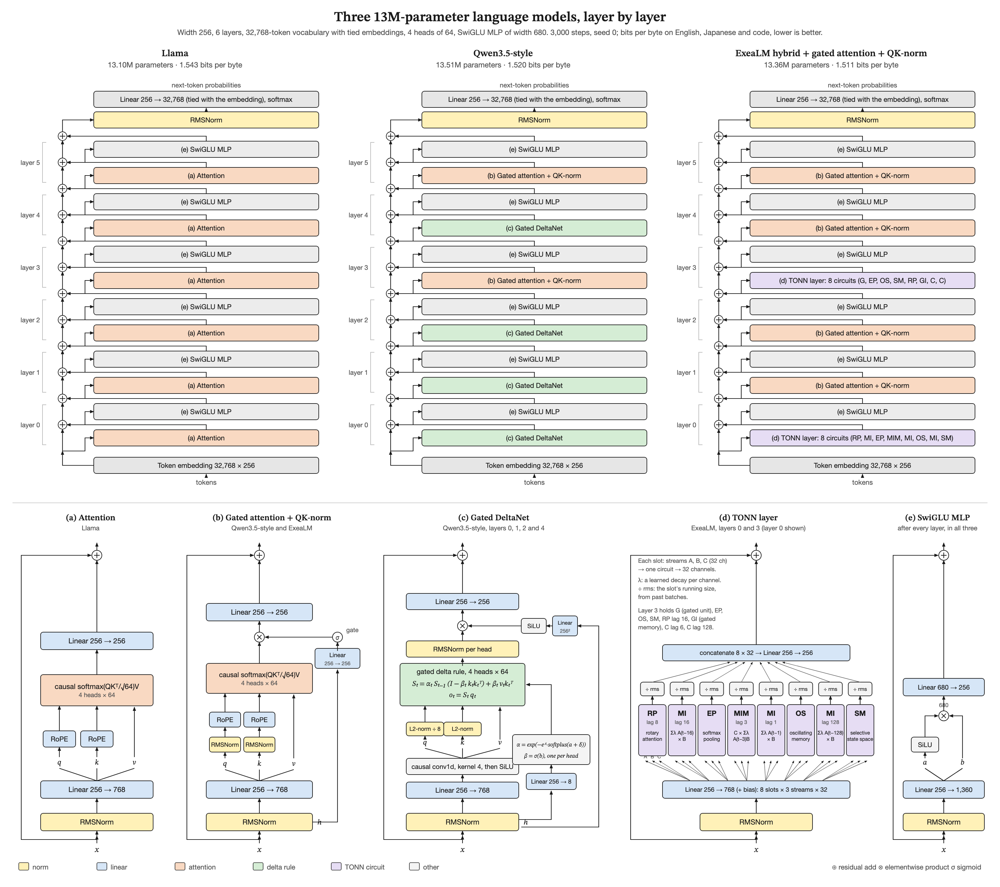

[English](README.md) | 日本語

# ExeaLM

高校生が作るオープンな言語モデルです。[Exea Labs](https://exealabs.org) が運営しています。コードと重みは Apache 2.0 で公開しています。

**アイデア**：ExeaLM は 0.1B パラメータ（約 1 億）の言語モデルです。ほかの LLM と同じように、約 1,000 億トークンでゼロから事前学習し、そのあと事後学習でアシスタントにします。違うのはアーキテクチャの **TONN**（トーン）です。TONN はすべての層に 2 つの新しい能力を組み込みます。1 つ目は**自前の検索拡張（RAG）**です。モデルは自分で埋め込みを学び、何を検索するかを決め、読み取り専用のデータストアからテキストを取り出します。2 つ目は**エージェント同士の通信**です。モデルのコピーどうしが共有の掲示板にメッセージを投稿し、互いのメッセージを読みます。どちらもネットワーク内部の回路で、ほかの部分と同じようにエンドツーエンドで学習します。あとから付け足すツールではありません。

**賭け**：0.1B のモデルでも、自分のサイズよりずっと大きな問題に取り組めます。すべてを 1 つでこなす必要がないからです。知識を 1 億個の重みにすべて収める必要はありません。モデルは自前の検索拡張で調べます。大きな問題を 1 つのコピーのコンテキストや能力に収める必要もありません。コピーのスウォームが仕事を分け、見つけたことを掲示板で共有します。2 つの能力は事前学習の最初のステップからアーキテクチャの一部です。そのためモデルは、最後に足したツールを通してではなく、言語を学ぶのと同じように検索と協力を学びます。これは検証中の仮説で、まだ結果ではありません。中心となる実験では、検索付きの 0.1B エージェントのスウォームと、より大きな単一のモデルを、同じ課題、同じ推論計算量で比べます。

**現状**：研究プレビューです。0.1B モデルはまだ学習していません。モデルのコード（TONN、検索回路、掲示板回路、アーキテクチャ探索）は動作し、テスト済みです。このコードで小さなモデル（13M から 18M パラメータと、短い 0.1B の学習）を学習しました。そのチェックポイント、トークナイザー、すべての結果ファイルは [Hugging Face](https://huggingface.co/exea-labs/ExeaLM) にあります。データのスクリプトは小さなサンプルで動きます。事前学習ループ、3 つの事後学習ループ（SFT、DPO、GRPO）、lm-evaluation-harness のアダプターは書いてあり、小さなモデルでテスト済みです。全データのダウンロードと大規模な学習は未着手のタスクです。

## 参加する

コントリビューターとして掲載するため、参加フォームに記入してください：https://docs.google.com/forms/d/e/1FAIpQLSdPHVZhuXxBDUf-cJM2zDbj1JZPsduu95Y_kTJ_g4gKAXdDVw/viewform

リポジトリは公開されているので、登録しなくても issue やプルリクエストを出せます。フォームは、誰がプロジェクトに参加したかの記録になります。始め方は [CONTRIBUTING.md](CONTRIBUTING.md) にあります。[to-do リスト](#to-do-リスト)から何か選んでください。ほとんどがノートパソコンか無料の Colab GPU で動きます。

## 5 分で始める

```bash
git clone https://github.com/exea-labs/ExeaLM && cd ExeaLM
pip install -e ".[dev,data]"
pytest                                                           # 約 1 分、CPU で十分です

# 作り物のデータで小さなモデルを学習します（ダウンロード不要、ノートパソコンの CPU で約 10 秒）
python -m exealm.train.pretrain --preset tiny --data synthetic --steps 300 --datastore_chunks 2000

# 公平な比較：同じ学習を、素のトランスフォーマーの比較対象で実行します
python -m exealm.train.pretrain --preset tiny --data synthetic --steps 300 --model llama --out runs/llama

# 実データ：LLM-jp コーパスの日本語 Wikipedia を 1 ファイル（約 320 MB）
python -m exealm.data.download llmjp --subset ja/ja_wiki --max_files 1 --out data/raw
python -m exealm.data.sources                                    # 1,000 億トークンの配合の候補 2 つを表示します
```

[Hugging Face](https://huggingface.co/exea-labs/ExeaLM) の研究用チェックポイントは 1 行で読み込めます。ターミナルで文章を書かせることもできます（`pip install huggingface_hub`）。これらはベースモデルです。テキストの続きを書きますが、まだ会話はできません。

```python
import exealm
model, tok = exealm.from_pretrained("17m/exealm_together_gated_seed0")
```

```bash
python -m exealm.chat --ckpt 17m/exealm_together_gated_seed0 --raw --swarm 4    # 4 つのエージェントが一緒にテキストの続きを書きます
```

初めての方へ：[notebooks/tiny_tour.ipynb](notebooks/tiny_tour.ipynb) は GPU のいらないガイド付きツアーです。CPU 1 スレッドで
5 分かかりません（[Colab で開く](https://colab.research.google.com/github/exea-labs/ExeaLM/blob/main/notebooks/tiny_tour.ipynb)）。
`tiny` モデルを学習し、回路を調べ、いくつかをオフにして、2 つのエージェントが掲示板で会話を覚える様子を見ます。

データの手順の全体（フィルター、トークナイザー、パック、そして 18M の `small` プリセットの学習。ノートパソコンか無料の Colab GPU に収まります）：[docs/data.md](docs/data.md)。

## 計画

### 1. アーキテクチャ：TONN

TONN は、データから自分のアーキテクチャを組み立てる系列モデルです。通常のトランスフォーマーの層は、アテンションと MLP でできています。TONN の層は代わりに 20 個の小さな**回路**を持ちます。回路は 14 種類のうちのどれかです。
- メモリ：遅延、漏れのある累積和、ゲート付きメモリ、Mamba に似た選択的状態空間、振動するメモリ
- 局所と大域の混合：短い畳み込み、回転位置アテンション
- 2 つの新しいメモリ回路（2 節と 3 節で説明します）

各 TONN 層のあとには、トランスフォーマーと同じようにゲート付き MLP が続きます。



*Llama、Qwen3.5 型モデル、ゲート付きアテンションと QK-norm を使う ExeaLM ハイブリッドです。13M パラメータで、
[results §12](results/README.md) で比較したものです。上：すべての層と残差接続。下：各ブロックの内部。
（a）アテンション、（b）QK-norm 付きのゲート付きアテンション、（c）Gated DeltaNet、（d）TONN 層と、最初の
TONN 層の 8 個の回路、（e）SwiGLU MLP。`docs/figures/arch_compare.py` で描画しています。*

**ExeaLM はハイブリッドです**。3 層に 1 層が TONN 層で、残りはフルアテンション層です（0.1B モデルでは TONN 層が 5、
アテンション層が 9）。TONN の最初の回路は短い畳み込みを多めにします。アテンション層は Qwen3.5 の部品を
2 つ使います。ゲート付きアテンション（出力チャンネルごとのシグモイドゲート）と QK-norm（各ヘッドのクエリとキーへの RMSNorm）です。
この 2 つでハイブリッドは 13M でバイトあたり 0.025 ビット（2 シード）、2 つのメモリ能力を持つ 17M の完全なモデルで 0.026（1 シード）良くなります。
0.1B モデルのパラメータは 4% 増えます（予定の語彙で 105M）。純粋な TONN は、実トークンで同じサイズの Llama に負けました。差の大半はコードです。
ハイブリッドは両方のシードで、すべての種類のテキストで Llama に勝ちます（バイトあたりビット数、
低いほど良い）。

| モデル（記載がなければ 13M パラメータ、3,000 ステップ） | 英語 | 日本語 wiki | 日本語ウェブ | コード |
|---|---|---|---|---|
| Llama 型トランスフォーマー（2 シード） | 1.467 | 1.540 | 1.420 | 1.789 |
| 純粋な TONN（2 シード） | 1.480 | 1.568 | 1.422 | 1.979 |
| **ExeaLM ハイブリッド（2 シード）** | **1.452** | **1.521** | **1.404** | **1.746** |
| *27M パラメータ：* Llama（2 シード） | 1.446 | 1.523 | 1.402 | 1.778 |
| *27M パラメータ：* **ExeaLM ハイブリッド（2 シード）** | **1.412** | **1.483** | **1.371** | **1.702** |
| *48M、学習時間をそろえた比較：* Llama（2 シード） | 1.369 | 1.439 | 1.333 | 1.667 |
| *48M、学習時間をそろえた比較：* **ExeaLM ハイブリッド、2:1 構成（2 シード）** | **1.366** | **1.436** | **1.327** | **1.653** |
| *0.1B（90M）、学習時間をそろえた比較：* Llama（1 シード、lr 1e-3） | 1.392 | 1.468 | 1.352 | 1.713 |
| *0.1B（90M）、学習時間をそろえた比較：* **ExeaLM ハイブリッド（1 シード、lr 1e-3）** | **1.373** | **1.451** | **1.339** | **1.692** |

これは小さな規模の短い学習です。6,000 ステップでもハイブリッドはすべての種類のテキストで上回りますが、差は縮まります
（0.006）。高速化のあと、ハイブリッドのトークンあたりのコストは 0.1B で Llama の 1.13 倍です。
同じ GPU で学習時間をそろえた比較では、13M で Llama と並び、27M で勝ちます。48M では、半分をアテンションにした構成は負けました（0.014）。
しかし 2:1 構成（TONN 層 1 つにアテンション層 2 つ）は、**48M で計算量をそろえた比較に勝ちます：1.445 対 1.452、両方のシード、すべての種類の
テキスト**。現在はこの構成が既定です。0.1B では、学習時間をそろえた比較で、両方のシードですべての種類のテキストで Llama を上回ります
（自身の学習率 1.5e-3 で 0.007 と 0.010、Llama の 1e-3 で 0.017 と 0.031）。詳細：
[results/README.md](results/README.md#8-overnight-sweep-making-tonn-beat-llama-experimentsrun_queuesh-resultssweep)。

どの回路をどこに置くかは、誰も決めません。学習中、TONN は学習に使っていないテキストの上で回路の種類ごとにオフにしてみて、誤差が増える場合だけ残します。役に立たない回路は新しい回路に置き換えます。新しい回路は、役に立つと分かった種類から多めに選びます。学習の序盤はアーキテクチャが変わり、その後は固定します。

論文：[TONN: Networks That Build Their Own Architecture from Data](https://www.preprints.org/manuscript/202611.0994)（Avneh Singh Bhatia、Preprints.org、2026 年 11 月）。コンセプト論文で、査読は受けていません。より大きな規模での結果は良いものと悪いものが混ざっています。そのため、大きな学習の前に、小さなモデルで TONN と素のトランスフォーマーを計算量をそろえて比較します。

言語モデルとしての証拠は、今のところ小さなテストだけです。4.85M パラメータ、バイト単位の英語ウェブテキスト（[FineWeb-Edu](https://huggingface.co/datasets/HuggingFaceFW/fineweb-edu)）で、どのモデルも同じ 25 MB の学習テキストを使いました。

| モデル | バイトあたりビット数（低いほど良い） |
|---|---|
| Llama 型トランスフォーマー、同じサイズ | 1.813 |
| TONN、シード 0 | **1.738** |
| TONN、シード 1 | 1.766 |
| トランスフォーマー、データ 3 倍（82 MB） | 1.690 |
| TONN、データ 3 倍（82 MB） | **1.622** |

注意点：
- TONN は現在、1 ステップあたりの学習が約 2.7 倍遅いです。カーネルをまだ最適化していないためです。
- シードによるばらつきは実際にあります。
- 4.85M パラメータは 0.1B からまだ遠いです。

このプロジェクトの最初の仕事は、この差がより大きな規模でも保たれるかを確かめることです。詳細：[docs/architecture.md](docs/architecture.md)。

### 2. 自前の検索拡張（RG 回路、読み取り専用）

すべての層に **RG** 回路が少なくとも 1 つあります。RG 回路は 64 トークンに 1 回、次のことをします。
1. ここまで読んだ内容を**クエリ**に変えます（RG 回路ごとに自分のクエリを学びます）。
2. 学習テキストのチャンクを収めた**読み取り専用のデータストア**を検索します。使うのは**モデル自身のエンコーダーが作った埋め込み**です（外部の埋め込みモデルは使いません）。
3. 上位の結果に、一致の度合いに応じた重みを付けます。
4. 各位置が、取り出したテキストをアテンションで読みます。

これらはすべて、次トークンの損失から学習します。データストアは、いま読んでいる文書のチャンクを返しません。そのため、モデルは答えを引いてくるというずるができません。

### 3. 互いに話すエージェント（AG 回路、読み書き）

すべての層に **AG** 回路が少なくとも 1 つあり、**掲示板**につながっています。64 トークンに 1 回（17M の学習では 8 トークンごと。リレー課題に必要なためです）、モデルの各コピーはメッセージを投稿します。メッセージには、何についてか、何を言うか、どれくらい強く読んでほしいかが入ります。強さを下げれば黙っていられます。各コピーはすべての位置で、同じスウォームのほかのエージェントが先に投稿したメッセージをアテンションで読みます。何も読まないことも選べます。データストアは読み取り専用ですが、掲示板は読み*書き*できます。推論時には、動いている多数のエージェントが永続的な掲示板を共有できます。

**まず保証し、あとは選ばせる**：すべての層は RG 回路 1 つと AG 回路 1 つを持って始まります。探索は最後の 1 つを取り除けません。どちらも、役に立つようになるまでに学習が必要だからです。役に立つ場所なら、探索は自由に回路を増やせます。設計と未解決の問い：[docs/memory.md](docs/memory.md)。

### 4. スウォーム：協力するエージェント

**スウォーム**は、1 つの掲示板を共有する数個のエージェント（既定は 4）です。学習では多数のスウォームを同時に動かします。各バッチをスウォームに分け、それぞれに専用の掲示板を持たせます。スウォームどうしは互いのメッセージを受け取りません。

- **事前学習：スウォームが一緒にデータを取り込みます**。各エージェントは通常の学習テキストを読むので、スウォームに追加のデータはいりません。スウォームは、あるエージェントが読む内容がほかのエージェントの助けになるように組みます。1 つの長い文書の各部分（実装済み）、関連する文書、同じ話題の日本語と英語（未着手）です。一部のスウォームはランダムに組みます。エージェントが掲示板を無視すべき場合も学べるようにするためです。各エージェントは自分でもデータストアを検索し、見つけたものを共有できます。
- **事後学習：スウォームが一緒に課題を解きます**。各エージェントは情報の一部を受け取り、そのうち 1 つが答えなければなりません。スウォームは 1 回の順伝播で動くので、答えの損失がすべてのエージェントのメッセージを直接学習させます。そのあと RL で、情報を分割した質問、分割統治の数学、書いてテストするコードを解いたスウォーム全体に報酬を与えます。

私たちの知る限り、ExeaLM はエージェント同士の通信をアーキテクチャに組み込んだ最初の言語モデルです。エージェントが役に立つことを伝えるようになると実験で示すまでは、これは設計であって結果ではありません。設計、ルール、未解決の問い：[docs/swarms.md](docs/swarms.md)。

### 5. データ：約 1,000 億トークン

オープンなコーパスから選びます。主なものは次のとおりです。
- **[FineWeb-Edu](https://huggingface.co/datasets/HuggingFaceFW/fineweb-edu)** と **[DCLM-Baseline](https://huggingface.co/datasets/mlfoundations/dclm-baseline-1.0)**：フィルター済みの英語ウェブテキストで、配合の中で最も大きな部分です。
- **[NII LLM-jp Corpus v4](https://gitlab.llm-jp.nii.ac.jp/datasets/llm-jp-corpus-v4)**：合計 19.5T トークンです。日本語 688B、英語 17.8T のほか、コード、中国語、韓国語を含みます。アカウントなしでダウンロードできます。
- **[K2 Horizon](https://ifm.ai/blog/k2) と一緒に公開されたデータ**（Institute of Foundation Models、[コレクション](https://huggingface.co/collections/IFM/k2-horizon)）：[TxT360-v2](https://huggingface.co/datasets/IFM/TxT360-v2)（ウェブと QA）、[Pretrain-Behaviors](https://huggingface.co/datasets/IFM/Pretrain-Behaviors)、[Math-Reasoning](https://huggingface.co/datasets/IFM/Math-Reasoning)、[Code-Reasoning](https://huggingface.co/datasets/IFM/Code-Reasoning)、[SFT-Reasoning](https://huggingface.co/datasets/IFM/SFT-Reasoning)。

1,000 億トークンの配合には候補が 2 つあります。DATA.md の配合（英語が多め）と、配合案 v0（日本語が約 21%）です。どちらにするかは小さなアブレーションで決めます。すべてのデータセットのリンクとライセンスは [DATA.md](DATA.md) と [docs/data.md](docs/data.md) にあり、2 つの配合は [`exealm/data/sources.py`](exealm/data/sources.py) にあります。

**なぜ 1,000 億トークンか**：トークンを増やすほど、得られる効果は小さくなります。0.1B のモデルに 100B トークンは、1 パラメータあたり 1,000 トークンです。計算量に対して最適な比率の約 50 倍で、これは意図したものです。Chinchilla の損失の当てはめでは、予測損失は 20B から 100B トークンで約 0.19、100B から 200B で約 0.06、200B から 400B で約 0.05 下がります。およそ 200B トークンを超えると、データを増やしても得るものはわずかです。計算は [DATA.md](DATA.md) にあります。

### 6. 学習

- **事前学習**：
  - warmup-stable-decay の学習率による次トークン予測。
  - アーキテクチャ探索は試験的な学習の間に行い、その後は固定します。
  - モデル自身のエンコーダーが学習するのに合わせて、検索インデックスを更新します。
  - 最も良いデータは、最後の減衰フェーズのために取っておきます。

  計算量：約 6 × 10¹⁹ FLOPs。トランスフォーマーの速度で MI300X の約 56 GPU 時間です。既定の ExeaLM はその速度で学習します。検索を入れるとさらに半分ほど増えます（約 85 GPU 時間）。8 GPU なら 1 日よりずっと短く済みます。[docs/training.md](docs/training.md)
- **事後学習**は次の順に行います。
  1. 会話データでの教師ありファインチューニング（[`sft.py`](exealm/train/sft.py)）
  2. 選好チューニング（[`dpo.py`](exealm/train/dpo.py)）
  3. **GRPO** による強化学習（[`grpo.py`](exealm/train/grpo.py)、DeepSeek-R1 で使われた手法）
  4. **スウォーム SFT とスウォーム RL**：スウォームは掲示板を共有し、一緒に学習して一緒に報酬を受けます。AG 回路が本当に会話を覚えるのはここです。
- **計算資源**：Exea が手配するクラウドの計算資源で、中央の学習を 1 回行います。参加するのに GPU はいりません。重みは https://huggingface.co/exea-labs/ExeaLM で公開します。

## これまでの結果

同じサイズのモデル、同じデータ、同じステップ数です（3,000 ステップ、約 49M トークン、AMD MI300X 1 台）。学習に使っていない
英語、日本語、コードでのバイトあたりビット数で、低いほど良い値です。すべてのシードは [results/funding/README.md](results/funding/README.md) にあります。

| サイズ | ExeaLM ハイブリッド | ExeaLM ハイブリッド、元の初期メニュー | Llama + ゲート付きアテンション + QK-norm | Qwen3.5 型（私たちの実装） | Llama |
|---|---|---|---|---|---|
| 13M | **1.511**（10 シード） | 1.523（5 シード、うち 1 つが弱い：1.567） | 1.522（10 シード） | 1.522（10 シード） | 1.550（5 シード） |
| 0.1B | **1.413**（3 シード） | 1.427（3 シード） | 1.446（3 シード） | 1.457（3 シード） | 1.509（3 シード） |

| メモリ能力（偶然の水準 1.6%） | 回路あり | 回路を切った場合 | どこで |
|---|---|---|---|
| 掲示板を通すリレー課題 | 99.8 から 99.9% | 最大 2.1% | 0.8M モデル、3 シード |
| 重みの編集を通すリレー課題（`wa_key="hidden"`） | 99.7 から 100% | 最大 2.1% | 0.8M モデル、6 回 |
| 未知の事実 1,024 件のライブラリでのルックアップ課題 | 94% | 1.6% | 主にテキストで学習した 18M モデル、2 シード |
| 1 つの 0.1B モデルでのリレー課題とルックアップ課題 | 99.4 から 100% と 75 から 78% | 0.8% と 1.6% | 94.7M、5 回のうち 2 回で学習が成立 |

これらはステップ数をそろえた比較の短い学習です。ハイブリッドは 32 ビット精度で 1 ステップに Llama の約 1.2 倍の時間がかかります
（bf16 では 1.6 倍）。Qwen3.5 型モデルは私たちが作った小さな実装で、公開されている重みではありません。通常のテキストで
損失を下げたメモリ回路は、まだありません。

- **0.1B では、ハイブリッドがすべてのシードですべての比較対象を上回ります**（1.413 に対し、ゲート付き Llama が 1.446、
  Qwen3.5 型モデルが 1.457）。最初の回路から回転位置アテンションを外すと、弱いシードがなくなりました。現在はこれが
  既定です。
- **エージェントは重みを編集して互いに教えられます**。重み書き換えスロットは、別のエージェントの MLP 行列に
  ランク 1 の変更を出します。学習したキーではリレー課題の事実の 52% が伝わりました。キーを編集先の層から取ると
  99.7 から 100% が伝わります。通常のテキストでは、自分を編集するスロットのコストはバイトあたり 0.003 から 0.005 ビットです。

Mac Studio での以前の小規模なテストです。すべて [results/README.md](results/README.md) にあります。
- **エージェントは会話を覚えます**。あるエージェントが持つ事実は、掲示板を通してだけ別のエージェントに届きます。掲示板ありで正解率 99.8%、
  なしで 1.5%（偶然の水準）、3 シードです。エージェントが 4 つのときは、1 つがほかの 3 つから事実を集めます。
- **モデルは自前の検索拡張を作ります**。ステップごとに変わる事実について、見たことのない 1,024 件の中から正しいものを見つけます。
  データストアありで正解率 100%、なしで 1.5%（偶然の水準）です。埋め込み、クエリ、読み方を自分で学びます。
  最初の設計はまったく学習しませんでした。何が壊れていたか、なぜかはレポートに書いてあります。実テキストでは、検索はまだ差し引きで得になっていません。
  完璧な検索なら Wikipedia の知識課題でトークンあたり 0.040 ビット良くなります。しかしモデル自身の検索が
  正しい記事を見つけるのは約 30% だけです。
- **1 つの 18M モデルが、テキストと並行して 2 つのメモリ能力を学びます**。主に実テキストで学習したこのモデルは、掲示板を通して
  エージェント間で事実を渡します（正解率 100%、掲示板を切ると 1%）。見たことのないライブラリで事実を調べることもできます
  （94%、ライブラリなしで 1.6%）。2 つの能力を最初のステップから一緒に教えると、両方のシードでこうなります。言語については
  同じサイズの Llama とほぼ同等です。ステップ数をそろえた比較では 2 シードでバイトあたり 0.011 ビット上回り、計算量をそろえた比較では
  並びます（[results §10](results/README.md#10-the-whole-model-at-17m-with-the-board-and-the-library-on-experimentsfull_smallpy-resultsfull_small)）。
  Qwen3.5 のゲート付きアテンションと QK-norm で 0.026 良くなり（1.393 対 1.419、1 シード）、2 つの能力も
  保たれます。学習全体を通した回路の探索は掲示板回路を増やし、言語で 0.012 のコストがかかります。
- **実テキストでのメモリは、まだ得になっていません**（[#27](https://github.com/exea-labs/ExeaLM/issues/27)）。学習に使っていない
  Wikipedia で、各記事の前半をモデルが学習していない知識として使いました。ライブラリ、動いている 2 つ目の
  エージェント、事前に書いたメモは、再登場する珍しい単語の損失をそれぞれ -0.10 から +0.01 ビット変えます。
  代わりに前半をコンテキストに入れると約 1 ビット、通常の BM25 による検索拡張では 0.34 ビット良くなります。実テキストで
  練習すると、ライブラリは害がなくなりますが、役には立ちません。その記事を読んだエージェントのメモでは最大 0.039 ビット良くなります。
  8,000 ステップ練習したあとは、256 記事すべてのメモを一度に与えると 7.9 ビット悪くなります。掲示板は
  別の記事のメモを無視することを学ぶ必要があります（[results §13](results/README.md#13-memory-on-real-text-experimentsirl_evalpy-resultsirl-issue-27)）。
- **実テキストでのスウォームの効果は再現しませんでした**。以前、条件をそろえた対照に対して、スウォームでバイトあたり 0.014 ビットの
  効果があると報告しました（PR #7 で見つかったリークを直したあとは 0.012）。再実行では、対照より 0.015 良い結果から 0.035 悪い結果まで幅があります。
  Mac の GPU では、同じ学習を 2 回実行しても最大 0.012 違います。シードを増やしてばらつき付きの数字が出るまでは、
  未証明として扱ってください（[#33](https://github.com/exea-labs/ExeaLM/issues/33)、[results §2](results/README.md#2-swarms-on-real-text-experimentsswarm_textpy)）。
- **トークナイザー：32k**。トークン予算を固定した比較で、英語、日本語、コードのすべてで 49k と 64k に勝つか並びます。
- **速度**：既定の 0.1B モデル（2:1 ハイブリッド）は、同じサイズの Llama と同じ速度で学習します（トークンあたり 1.01 倍）。検索を入れると 1.49 倍です。
- **純粋な TONN は実トークンで Llama に負け、ハイブリッドは勝ちます**。純粋な TONN は同じサイズの Llama に及びませんでした。差の大半はコードです。
  ハイブリッド（アテンション層の間に TONN 層を置き、畳み込みを多めにして始める）は、両方のシードで英語、日本語、コードのすべてで
  Llama に勝ちます。サイズとステップ数をそろえた比較（13M、27M、48M）で勝ちます。TONN 層 1 つにアテンション層 2 つの構成では、
  学習時間をそろえた比較でも 48M（バイトあたり 0.007 ビット）と 0.1B（lr 1e-3 で 0.024、両方のシード、メモリ回路なしの
  短い学習）で勝ちます。現在はこれが既定のアーキテクチャです。

## to-do リスト

出発点の一覧です。ここにあるほとんどすべてが、`tiny` プリセットか 18M パラメータの `small` プリセットを使って、ノートパソコンか無料の Google Colab GPU で動きます。（**入門向け**）と付いた項目は、最初のタスクに向いています。（**GPU**）と付いた項目は、より大きな GPU が必要です。それらはメンテナーが Exea の計算資源で実行します。その場合でも、コードを書いて小さなモデルでテストすることはできます。多くの項目は、詳細と完了の定義を書いた GitHub issue になっています：[good first issues](https://github.com/exea-labs/ExeaLM/issues?q=is%3Aopen+label%3A%22good+first+issue%22) と [help wanted](https://github.com/exea-labs/ExeaLM/issues?q=is%3Aopen+label%3A%22help+wanted%22)。項目を担当するには、その issue にコメントするか、#exealm で伝えるか、ドラフトのプルリクエストを出してください。モデルや学習を変えるものは、まず小さな規模の公平な比較で勝つ必要があります（[CONTRIBUTING.md](CONTRIBUTING.md)）。

### スウォームとエージェント（`exealm/model/board.py`、`exealm/data/loader.py`、[docs/swarms.md](docs/swarms.md)）
- [x] 仕組みの実証：エージェントは学習中に掲示板で事実を渡すことを覚えます。99.8% に対し、掲示板を切ると 1.5% です（[結果](results/README.md#1-agents-learn-to-talk-through-the-board-during-training-experimentsswarm_relaypy)）
- [x] 最初の実テキスト実験：5M パラメータで、分割スウォームは条件をそろえた対照をバイトあたり 0.006 ビット上回ります。分割バッチのコストは 0.021 です（[結果](results/README.md#2-swarms-on-real-text-experimentsswarm_textpy)）
- [ ] 実テキストでのスウォームの効果は本物か。再実行では対照より 0.015 良い結果から 0.035 悪い結果まで幅があり、同じ学習を 2 回実行しても最大 0.012 違います。両方の継ぎ目の設定で、あと 3 シードが必要です（[#33](https://github.com/exea-labs/ExeaLM/issues/33)）
- [x] 両方の能力を持つ 1 つのモデル：17M モデルは、ステップ 0 から両方を一緒に教えると、テキストと並行してリレー課題とルックアップ課題を学びます（[#26](https://github.com/exea-labs/ExeaLM/issues/26)）
- [x] 実テキストでの掲示板：ペアバッチ（記事の半分を読むエージェントのメッセージを、もう半分を読むエージェントが最初のトークンから受け取る）を `experiments/irl_eval.py` で評価します。その記事を読んだエージェントのメモでは最大 0.039 ビット良くなります。長く練習したあとは、256 記事すべてのメモを一度に与えるとモデルが壊れます（[#27](https://github.com/exea-labs/ExeaLM/issues/27)、[results §13](results/README.md#13-memory-on-real-text-experimentsirl_evalpy-resultsirl-issue-27)）
- [ ] 大規模なメモの知識ベース：保存したメモのすべてにアテンションをかける代わりに、メモを検索します（[#28](https://github.com/exea-labs/ExeaLM/issues/28)）
- [ ] 単独バッチと同じ数の独立したテキスト区間を保つスウォームバッチ（上記の 0.021 のコスト）（[#19](https://github.com/exea-labs/ExeaLM/issues/19)）
- [x] （入門向け）学習中の掲示板の使われ方を測る：探索ログの AG の有用度、エージェントが何も読まない頻度、投稿の強さ（評価記録の `board`、探索記録の `board_worth`）
- [ ] 関連スウォーム：モデル自身の検索空間で互いに近い文書をまとめます
- [ ] 言語をまたぐスウォーム：同じ話題の日本語と英語の Wikipedia 記事を組にします（言語間リンク）（[#23](https://github.com/exea-labs/ExeaLM/issues/23)）
- [ ] 1 回の学習の中でスウォームのサイズを変える（2 から 8）
- [x] 重み書き換え回路（`WA`、`exealm/model/alter.py`、オプトイン）：自分のエージェント、または同じスウォームのほかのエージェントの MLP 重み行列にランク 1 の変更を出すスロットです。通常の損失から学習します。変更は 1 回のパスの間だけ有効です（[docs/memory.md](docs/memory.md)）
- [ ] パスをまたいで残る重みの変更（永続的な掲示板のようなストア）と、編集が保存済みのパラメータに届く前の安全性レビュー
- [ ] 重みの編集はいくつの事実を運べるか。事実が 4、8、16、32、64 件のリレー課題で、掲示板と重み書き換えを比べます（`experiments/swarm_relay.py --facts N --memory WA --wa_key hidden`。0.8M モデルで、ノートパソコンの CPU か Colab で動きます）（[#58](https://github.com/exea-labs/ExeaLM/issues/58)）
- [ ] エージェント 4 つでの重み書き換え（書き手 3 つが読み手 1 つを編集）と、より後ろの層を対象にした重み書き換え（`wa_target`）
- [ ] `wa_key="hidden"` を使った統合 0.1B モデルでは、リレー課題は重みの編集だけで伝わり、掲示板は使われませんでした（1 シード）。シードを増やしても同じか。事実が 1 チャンクより長いとき、掲示板は再び使われるか
- [ ] 実テキストから作るリレー課題（あるエージェントが段落を読み、別のエージェントがそれについて答える）。作り物の課題の外で掲示板と重み書き換えを比べます
- [ ] エージェントの識別：エージェントが専門化できるよう、投稿に役割または id の信号を付けます
- [ ] 検索の分業：スウォーム内のエージェントは別々のチャンクを取り出すか。それに報酬を与えてみます
- [ ] スウォームを考慮したマルチ GPU 学習。各スウォームを 1 つの GPU に置きます（CPU 上の 2 プロセスでテストできます）
- [ ] スウォーム SFT のデータ：マルチホップ QA から作る、情報を分割した課題。[DATA.md](DATA.md) の「tool use and agentic」の不足もこれで埋まります
- [ ] スウォーム SFT ループ：答えるエージェントに損失をかけ、掲示板を通して学習します（`tiny` プリセットでテスト）
- [ ] スウォーム RL（GRPO）：スウォーム全体で試行し、報酬を共有します（`tiny` プリセットでテスト）
- [ ] スウォーム課題集：情報を分割した QA、分割統治の数学、書いてテストするコード、提案と検証、言語をまたぐ QA
- [x] スウォーム生成：すべてのエージェントが 1 つのバッチの中で歩調を合わせて生成します（`exealm/generate.py`：1 ステップにつきエージェントごとに新しいトークンを 1 つ出し、各エージェントは自分で止まり、スウォームはバッチ内の掲示板を共有します）
- [x] 別々のマシンのエージェントが 1 つの掲示板を共有するための掲示板サーバー（HTTP：`python -m exealm.memory.board_server`、`RemoteAgentBoard`。[docs/memory.md](docs/memory.md)、[#35](https://github.com/exea-labs/ExeaLM/issues/35)）。サーバーは 1 プロセスで、掲示板はメモリ上にあります
- [ ] メッセージデコーダー：掲示板のメッセージを人が読めるテキストに変えます（[#34](https://github.com/exea-labs/ExeaLM/issues/34)）
- [ ] 安全性：エージェントは、ほかのエージェントのメッセージを指示ではなく情報として扱います（データと評価）
- [ ] スウォーム評価：同じ課題を、単独と、2、4、8 のスウォームで比べます
- [ ] 中心となる評価：検索付きの 0.1B エージェントのスウォームと、より大きな単一のオープンモデル（たとえば 1B）を、同じ大きな課題、同じ推論計算量で比べます。評価の仕組みは、いま `tiny` のチェックポイントと小さなオープンモデルで作ってテストします

### 検索（`exealm/model/retrieval.py`、`exealm/memory/datastore.py`）
- [x] データストア用の FAISS（IVF-PQ）インデックス（`exealm/memory/faiss.py`、任意。既定は厳密検索のままです。ランダムなキー 1M 件では、サブ量子化器 16 個とプローブ 32 個で厳密な上位 4 件の 85% を見つけ、厳密検索より高速です。[results/faiss_datastore](results/faiss_datastore/README.md)、[#15](https://github.com/exea-labs/ExeaLM/issues/15)）
- [ ] 学習で使う前に、実際の検索キーとモデルの損失で FAISS と厳密検索を比べます
- [ ] データストアに何を入れるかを決める：厳選した数十億トークンの参照テキスト
- [ ] 再インデックスのスケジュール：保存したキーはどこまで古くなってよいか（`small` プリセット）
- [ ] より安い検索：エンコード結果のキャッシュ、層をまたいだ検索の共有、top-k とチャンク長の調整
- [ ] キーのサイズ：数値 32 個、64 個、128 個の比較（`small` プリセット）
- [x] （入門向け）プロンプトに対して RG が何を検索したかを表示するスクリプト（`python -m exealm.eval.show_retrieval`）
- [x] 推論時にデータストアを入れ替える：モデルが見たことのない合成の事実で、新しいライブラリを使って正解率 94%（2 シード、17M）
- [ ] 同じことを実テキストで：モデルが学習していない文書のライブラリ（[#27](https://github.com/exea-labs/ExeaLM/issues/27)）。正しい実文書で読み方を学習させると（`--wiki_oracle`）、ライブラリは害がなくなりますが、役には立ちません
- [x] 実テキストのテストに対する通常の検索拡張の比較対象：BM25 で検索したテキストをプロンプトに入れると、再登場する単語で 0.34 ビット良くなります。正しい記事をコンテキストに入れると 1.0 です（[#32](https://github.com/exea-labs/ExeaLM/issues/32)）
- [ ] 実テキストで検索が得になるようにする。完璧な検索なら Wikipedia の知識課題でトークンあたり 0.040 ビット良くなります。キーに珍しい単語のコードを入れると、検索のヒット率は 12% から 30% に上がります。しかし検索なしのモデルに対する差し引きの効果はまだ確立していません（2 シードで +0.026 と -0.002。results §6）。次に試すこと：より良いプーリング、ハードネガティブ、より大きなエンコーダー、より大きなモデル（[#22](https://github.com/exea-labs/ExeaLM/issues/22)）

### アーキテクチャ（`exealm/model/`）
- [x] 実トークンでの `small` プリセットによる TONN 対 Llama、各 2 シード：Llama が上回り、差はコードで最大です（[結果](results/README.md#7-tonn-vs-llama-on-real-tokens-experimentstokenizer_lmpy---models-)）
- [x] 差を埋める：TONN 層とアテンション層を交互に置き、畳み込みを多めにして始めると、サイズとステップ数をそろえた比較（13M、27M）と、27M での計算量をそろえた比較で Llama に勝ちます（[結果](results/README.md#8-overnight-sweep-making-tonn-beat-llama-experimentsrun_queuesh-resultssweep)）
- [x] 計算量をそろえた比較でのハイブリッドのリードを 48M で確認し（1.445 対 1.452、両方のシード）、次に 0.1B で確認しました（1e-3 で 0.024、両方のシード。メモリ回路なしの短い学習）
- [x] ハイブリッドの構成：ステップ数をそろえた比較では、アテンション層の数はほとんど影響しません（13M、2 シード）。計算量をそろえた比較では、TONN 層 1 つにアテンション層 2 つの構成が勝ちます（48M）。現在はこれが既定です
- [x] スウォームと検索の実験をハイブリッドでやり直す（以前は純粋な TONN で実行していました）
- [ ] `small` サイズでのアブレーション：RG、AG、スウォームのありとなし
- [x] Qwen3.5 の線形アテンションである Gated DeltaNet を層として実装（`exealm/model/delta.py`、漸化式と照らしてテスト済み）。ゲート付きアテンションと QK-norm はオプションとして実装。13M（1 シード）では、ゲート付きアテンション + QK-norm でハイブリッドがバイトあたり 0.025 ビット良くなり、Qwen3.5 型モデルを上回ります。DeltaNet 層を足しても上積みはありません（[results §12](results/README.md)）
- [x] ゲート付きアテンション + QK-norm を既定にする：2 シードで保たれ（1.511、1.512）、ステップ数をそろえた比較と計算量をそろえた比較でゲート付き Llama と Qwen3.5 型モデルに勝ち（1.509 対 1.515 と 1.542）、両方の能力を持つ 17M の完全なモデルも良くなります（1.393 対 1.419）（[results §10, §12](results/README.md#12-parts-from-qwen35-exealmmodeldeltapy-experimentstokenizer_lmpy---llama_cfg)）
- [ ] 17M の完全なモデルとゲート付き Llama を同じバッチで比べる（ExeaLM がゲート付きになった今、これが公平な比較対象です）
- [ ] Gated DeltaNet を、探索が選べる TONN の回路の種類にする（[#30](https://github.com/exea-labs/ExeaLM/issues/30)）。ほかの新しい種類、たとえばスライディングウィンドウアテンション
- [x] まだ測定されていない回路は、読んでいるバッチでスケールされていました。そのため最初の学習ステップまで、出力が後ろのトークンとほかの行に依存していました。[#47](https://github.com/exea-labs/ExeaLM/pull/47) で修正しました（最初の測定までは定数のスケール）。13M の実テキストでは、この修正でスコアはバイトあたり 0.0001 ビット変わります（3 シード、[results/funding](results/funding/README.md)）
- [x] 回転位置アテンションを外した初期メニューが、ハイブリッドの既定です（`exealm/config.py` の `HYBRID`。探索はこの種類をあとから追加できます）。13M の 10 シードで 1.511（Qwen3.5 型 1.522、ゲート付き Llama 1.522）、0.1B の 3 シードで 1.413 でした（元のメニュー 1.427、ゲート付き Llama 1.446、Qwen3.5 型 1.457）
- [ ] （GPU）同じ比較を bf16 で学習時間をそろえて行う。bf16 では、0.1B でハイブリッドが 1 ステップあたり Llama より 1.6 倍遅くなります。ゲート付き Llama に対する 0.033 のリードは残るか。この項目と続く GPU 項目のジョブ一式は、すぐ実行できる形で [experiments/gpu_session](experiments/gpu_session/README.md) にあります
- [ ] （GPU）より長い学習：0.1B でのリードは 10 倍のトークン（約 500M）でも保たれるか
- [ ] （GPU）スケールアップ：0.5B、1B、3B で同じ比較を行い、サイズによってリードがどう変わるかを見ます
- [ ] 初期メニューのほかの回路の種類のうち、どれが害になり、どれが役に立つか。13M で種類を 1 つずつ外し、各 3 シードで調べます（Colab で動く規模）（[#59](https://github.com/exea-labs/ExeaLM/issues/59)）
- [x] 重み書き換えは、リレー課題で掲示板が伝える量の約半分しか伝えませんでした（52% 対 99.8%）。モデルが値をキーに結び付けることを学ばなかったためです。キーを編集先の層から取ると（`wa_key="hidden"`）、99.7 から 100% が伝わります（6 回）
- [x] `wa_key="hidden"` を使った重み書き換えを、実テキストと統合モデルで試す：13M でバイトあたり 0.003 から 0.005 ビットのコストがかかります（3 シード）。統合 0.1B モデルでは、これだけでリレー課題を伝えます（100%、1 シード）
- [ ] 統合 0.1B のレシピ（テキストにリレー課題とルックアップ課題のバッチを混ぜる）は、ExeaLM の 5 回の学習のうち 2 回で学習が成立しました。ログには 1,000 ステップに 1 行しかなかったため、原因は不明です。`experiments/full_small.py` は現在、100 ステップごとにバッチの種類ごとの損失と勾配ノルムを表示します（`--log_every`）。また、現在のサイズを学習し終えてからルックアップ課題のデータストアを大きくすることもできます（`--grow_when`）。どちらも実データでは未検証です。（**GPU**）この 2 つを使って 5 つの設定を再実行し、失敗した学習がうまくいった学習からどこで離れるかを見つけます
- [ ] パラメータ数を固定した形状のスイープ：深さ、幅、層あたりのスロット数、スロットあたりのチャンネル数
- [ ] 探索のスケジュール：どれだけ長く探索するか、どれだけ置き換えるか、新しい回路をどれだけ長く保護するか（良い初期状態のハイブリッドでは、現状の上積みは約 0.001 です）
- [ ] 探索は弱い初期状態を直せませんでした。13M の弱いシードでは、学習全体で回路を 1 つしか置き換えませんでした（1.565 対 1.567）。有用度のスコアがある種類を役に立たないと示したときに、もっと置き換えるようにします。`results/funding` のシード 4 と 6 でテストします
- [ ] どの回路の種類が探索で生き残るか。それは `tiny` と `small` で変わるか
- [x] （入門向け）探索が選んだアーキテクチャを、層ごとに、学習の経過に沿って図にする：`experiments/plot_search.py`（[図と結果](results/README.md#11-what-the-search-chooses-experimentsplot_searchpy-resultssearch_arch)、[#11](https://github.com/exea-labs/ExeaLM/issues/11)）
- [x] （GPU）勝ったモデルを 0.1B のフルサイズで確認：ステップ数をそろえた比較で各 3 シード。ハイブリッド 1.413（元のメニューでは 1.427）、ゲート付き Llama 1.446、Qwen3.5 型 1.457、Llama 1.509（[results/funding](results/funding/README.md)）

### 速度（`exealm/model/scan.py`）
- [ ] `decay_scan` と `gated_scan` の融合 Triton カーネル（無料の Colab T4 を含め、どの NVIDIA GPU でも動きます。AMD MI300X でも動く必要があります）（[#16](https://github.com/exea-labs/ExeaLM/issues/16)）
- [ ] コンパイルしやすい TONN 層：すべての回路の種類を 1 つのコードパスにして、`torch.compile` が融合できるようにします（現状の高速化はハイブリッドで 8%、Llama で 20% です）（[#24](https://github.com/exea-labs/ExeaLM/issues/24)）
- [ ] 1 つの層にあるすべての累積和回路を、1 回の scan 呼び出しで処理する
- [ ] メモリ回路の時間がどこにかかっているかをプロファイルする：掲示板とライブラリを入れた 17M モデルは、1 ステップあたり Llama の 1.30 倍です（[#29](https://github.com/exea-labs/ExeaLM/issues/29)）
- [ ] MI300X の bf16 では、ハイブリッドは 0.1B と 0.5B で 1 ステップあたり Llama より 1.6 倍遅くなります（32 ビットでは 1.2 倍）。bf16 で最も遅くなる回路を見つけて直します（[スループット](results/funding/README.md)）
- [ ] flash-linear-attention を使った、NVIDIA 上の高速な Gated DeltaNet（[#31](https://github.com/exea-labs/ExeaLM/issues/31)）
- [ ] 再帰状態のキャッシュ。トークンを 1 つ生成するたびにコンテキスト全体を読み直さずに済むようにします
- [ ] `torch.compile` への対応
- [x] 学習速度のベンチマーク：既定の 2:1 ハイブリッドのコストは、トークンあたり同じサイズの Llama の 1.01 倍、検索を入れると 1.49 倍です（純粋な TONN は 1.5 倍でした）（[結果](results/README.md#5-speed-of-the-real-model-experimentsspeedpy)、`experiments/speed.py`）
- [x] （入門向け）生成速度：`python -m exealm.eval.speed` は、学習と生成の 1 秒あたりのトークン数を同じサイズの Llama と比べて計測します
- [ ] （GPU）MI300X でテストと短い学習を実行し、何が壊れるかを報告する

### データ（[DATA.md](DATA.md)、`exealm/data/`）
- [ ] DATA.md のすべてのソースをダウンロードして配置する：並列、再開可能、チェックサム付き（サンプルで作ってテストします）
- [ ] （入門向け）K2 Horizon の各サブセットのトークン数を数える（ストリーミングで読むので、大きなダウンロードは不要です）（[#8](https://github.com/exea-labs/ExeaLM/issues/8)）
- [x] （入門向け）K2 Horizon の事前学習と SFT の 24 サブセットそれぞれに対する、検証付きのフォーマッター（`exealm/data/formatters.py`：壊れた行は、メタデータからテキストに変えずに捨てます。[#9](https://github.com/exea-labs/ExeaLM/issues/9)）
- [ ] K2 の guru-RL の課題と報酬のローダー（[#9](https://github.com/exea-labs/ExeaLM/issues/9) のうち、まだ残っている部分）
- [x] すべてのソースをまたいで、ほぼ重複した文書を取り除く（MinHash LSH、CPU で動きます）：`python -m exealm.data.dedup`
- [ ] 報告するすべてのベンチマークに対して汚染を取り除く（[#20](https://github.com/exea-labs/ExeaLM/issues/20)）。実装済み：7 つのベンチマークの評価用テキストをデータセットのリビジョン付きで書き出す機能（`exealm/data/benchmarks.py`）と、それと 13 トークンの並びを共有するパック済み文書を落とすフィルター（`exealm/data/decontam.py`）。フィルターはすべての窓を numpy でハッシュし、ハッシュが一致した場所だけを厳密に比較します。ノートパソコンの 1 コアで毎秒約 4M の学習トークンを処理します（ランダムなトークン、ベンチマーク 3M トークン）。100B トークンなら約 7 コア時間で、ソースごとに分割できます。残り：実際の配合で実行すること
- [ ] 個人情報と有害な表現をフィルターする
- [ ] 日本語ウェブテキストの品質分類器（小さな分類器、Colab で動く規模）（[#25](https://github.com/exea-labs/ExeaLM/issues/25)）
- [ ] 配合のアブレーション：`small` プリセットで配合を 3、4 種類試します。上位 2 つを 0.1B で確認します（**GPU**）
- [x] 多数のシャードファイルにソースごとの重みを付けるローダー（`loader.py` の `ShardSet`、`MultiShards`、`open_data`。事前学習では `--data mix.json`）。トークンファイルは最初に使うときにメモリマップされ、開いたままにするのは少数だけです
- [ ] （入門向け）データカード：すべてのソース、ライセンス、フィルター、トークン数（[#10](https://github.com/exea-labs/ExeaLM/issues/10)）

### トークナイザー（`exealm/data/tokenizer.py`）
- [x] 32k、49k、64k の候補を学習し、トークンあたりのバイト数と小さなモデルの損失で比べる：32k が勝つか並びます（[結果](results/README.md#4-tokenizer-size-experimentstokenizer_comparepy-experimentstokenizer_lmpy)）
- [ ] より大きなモデルで 32k と 49k を再確認し、そのあとトークナイザーを Hugging Face で公開する
- [ ] 特殊トークンの確定：チャットの役割、エージェントの役割、掲示板

### 学習（`exealm/train/pretrain.py`）
- [ ] マルチ GPU：DDP、次に FSDP（DDP は CPU 上の 2 プロセスでテストできます）（[#17](https://github.com/exea-labs/ExeaLM/issues/17)）
- [x] チェックポイントからの厳密な再開（`--save_every`、`--stop_at`、`--resume auto`）
- [x] Weights & Biases へのログ記録（`exealm.train.pretrain` の `--wandb PROJECT`。再開した学習は同じ W&B の run を続けます）
- [ ] 学習の終盤でのコンテキスト拡張
- [ ] オプティマイザー：Muon 対 AdamW（`small` プリセット）（[#21](https://github.com/exea-labs/ExeaLM/issues/21)）
- [ ] 複数トークン予測ヘッド（`small` プリセット）
- [ ] 小さなモデルからの学習率の転用（μP）：`tiny`/`small` で調整し、0.1B に引き継ぎます
- [x] （入門向け）予算表：学習 1 回あたりの GPU 時間、チェックポイントの間隔、まかなえる範囲（[docs/budget.md](docs/budget.md)）

### 事後学習（`exealm/train/`）
- [x] SFT ループとデータローダー（`python -m exealm.train.sft --ckpt ... --data conversations.jsonl.gz`）：1 行に 1 会話です。右側をパディングし、長さでまとめるので、会話どうしは互いに見えません。`tiny` でテスト済み：作り物の質問応答課題を学習し、チャットのデモで答えます
- [x] SFT、選好、RL 課題のデータ整形（`python -m exealm.data.post --list`）：公開されている 8 つのソースを、3 つのループが読むファイルに変換します。それぞれにライセンスと確認時のリビジョンを記録しています。ソースごとに実際の 100 行で確認しました（[results/post_data](results/post_data/live_check.json)）。IFM/SFT-Reasoning は発話に分けられないので、事前学習用テキストのままです
- [x] DATA.md の配合で SFT のデータを組むスクリプト（`python -m exealm.data.post_mix --missing empty`）：数学、コード、科学の推論データ（OpenMathReasoning、OpenCodeReasoning、OpenThoughts3）と Tulu 3 の安全性サブセットを整形し、トークン数は `sft.py` が学習するとおりに数えます。データのないバケットは「欠けている」と報告し、ほかのバケットのデータでは埋めません。2,705 行の試しの配合で `tiny` を学習できました（[docs/data.md](docs/data.md#the-sft-mix)）
- [ ] 10 億から 20 億トークンの SFT 配合を実際に組み、トークン数を数える。その前に、長い推論の扱いを決める（`sft.py` の 1,024 トークンでは 99% が答えの前で切れます）、WildChat とツール利用の割合を空けるか（`--missing empty`）配り直すか（`redistribute`）決める、安全性のデータを増やす（Tulu 3 の安全性サブセットは約 1,100 万トークンで、15 億の 1% 未満です）
- [ ] 実ユーザー会話のバケットのために WildChat-1M を整形する（個人情報と有害表現のフィルターのあと）
- [x] DPO ループ（`python -m exealm.train.dpo --ckpt ... --data prefs.jsonl.gz`）：開始時のモデルの凍結したコピーを参照にします。SFT と同じく 1 行に 1 つの答えです。`tiny` でテスト済み：選ばれた答えを好むことを学習します
- [x] DPO データ：英語の選好データ 3 つを整形しました（`exealm/data/post.py` の `tulu3-pref`、`dolci-pref`、`ultrafeedback`）
- [ ] 日本語の選好ペア：公開されているものがまだ見つかっていません
- [x] 数学とコードの報酬を使う GRPO ループ（`python -m exealm.train.grpo --ckpt ... --data tasks.jsonl.gz`）：課題ごとに答えのグループをサンプルして採点し、固定した参照モデルに対して更新します。報酬は `math`（boxed の答え、または最後の数）、`exact`、`code`（答えをテストコードと一緒に実行します。`--allow_code_exec` がなければ拒否します）です。`tiny` でテスト済みで、最もありそうな答えが間違っていたモデルを直します
- [ ] 指示追従の制約（RLVR）と日本語の課題の報酬、コード報酬のための本物のサンドボックス
- [x] チャットテンプレート（`exealm/chat.py`：`chat_prompt` と、同じ形式の Jinja テンプレート。同じトークンになることをテスト済み）
- [ ] 長い推論の過程は、これほど小さなモデルの助けになるか。SmolLM2-135M のような既存の小さなオープンモデルでテストします（Colab）。比べるデータは `post.py --think strip` と `--max_think_chars` で作れます

### 評価（`exealm/eval/`）
- [x] （入門向け）lm-evaluation-harness のラッパー（`python -m exealm.eval.harness --ckpt ... --tasks hellaswag`。[docs/evaluation.md](docs/evaluation.md)、[#12](https://github.com/exea-labs/ExeaLM/issues/12)）。単独、貪欲法で、チャットテンプレートはまだありません
- [ ] 日本語の評価（llm-jp-eval）
- [x] 検索の評価：ライブラリにはあるがプロンプトにはない答え（`experiments/irl_eval.py`：学習に使っていない Wikipedia で再登場する珍しい単語、ビット数、top-1、四択）（[#18](https://github.com/exea-labs/ExeaLM/issues/18)）
- [x] すべてのチェックポイントで評価を自動実行する（`python -m exealm.eval.auto --run <run folder> --tasks hellaswag --watch 300`：学習と並行して各チェックポイントを 1 回ずつ採点し、`evals.jsonl` と `evals.md` の表に書き込みます）
- [x] この README の結果の表（[これまでの結果](#これまでの結果)の下）

### リリース、ドキュメント、コミュニティ
- [x] Hugging Face のモデルカードとローダー。モデルを 1 行で読み込めます（`exealm.from_pretrained("17m/exealm_together_gated_seed0")`、`exealm/hub.py`）
- [x] デモ：1 つのエージェントまたはスウォームとチャットする（`python -m exealm.chat`。`--raw` はテキストの続きを書きます。現在のベースチェックポイントにできるのはこれです）
- [ ] チェックポイントが事後学習を終えたら、デモをウェブに載せる（Hugging Face Space）
- [x] （入門向け）図：TONN 層、RG、AG、スウォーム（インタラクティブ、ブログに掲載：https://blog.exealabs.org/architecture/）
- [x] （入門向け）この README の日本語訳（[README.ja.md](README.ja.md)、[#13](https://github.com/exea-labs/ExeaLM/issues/13)）。日本語話者による確認が必要です。to-do リストが変わったら、このファイルも合わせて更新します
- [x] （入門向け）用語集（[docs/glossary.md](docs/glossary.md)）
- [x] （入門向け）初心者向けノートブック：`tiny` モデルを学習し、中を見る（[notebooks/tiny_tour.ipynb](notebooks/tiny_tour.ipynb)、[Colab で開く](https://colab.research.google.com/github/exea-labs/ExeaLM/blob/main/notebooks/tiny_tour.ipynb)、[#14](https://github.com/exea-labs/ExeaLM/issues/14)）
- [ ] テクニカルレポート

## リポジトリの構成

```
exealm/
  config.py              モデルのサイズ："100m"（本番、105M パラメータ）、"small"（18M、ノートパソコン/Colab）、"tiny"（テスト用）
  model/
    tonn.py              TONN 層とモデル全体
    circuits.py          回路のメニュー
    retrieval.py         RG：モデル自前の検索拡張エンジン
    board.py             AG：掲示板回路
    search.py            有用度の測定と回路の置き換え
    scan.py              累積和の漸化式（高速なカーネルが必要）
    baseline.py          比較対象の Llama 型トランスフォーマー
  memory/
    datastore.py         読み取り専用の検索データストア（faiss.py：任意の近似検索）
    board.py             永続的な読み書き可能な掲示板（board_server.py、board_http.py：HTTP で共有）
  generate.py            1 つのエージェントまたはスウォームの、歩調を合わせた生成
  chat.py                チャットテンプレートとターミナルのデモ
  hub.py                 from_pretrained：ファイルまたは Hugging Face からチェックポイントを読み込む
  data/                  ソースとライセンス、ダウンロード、K2 フォーマッター、品質フィルター、トークナイザー、パック、スウォームバッチ、
                         ベンチマークの書き出しと汚染の除去
  train/                 pretrain、sft、dpo、grpo
  eval/                  評価の計画、lm-evaluation-harness のアダプター、検索とスウォームの評価
docs/                    アーキテクチャ、メモリ（検索拡張とエージェント）、スウォーム、データ、学習、アイデア
experiments/             実験ごとに 1 スクリプト（スウォームのリレー課題、テキストでのスウォーム、検索拡張のルックアップ課題、テキストでの検索拡張、
                         トークナイザー、TONN 対 Llama、速度）
results/                 実験で分かったこと：results/README.md と、生の JSON とログ
notebooks/               tiny_tour.ipynb：新しいコントリビューター向けの tiny モデルのガイド付きツアー（Colab、CPU）
tests/                   pytest で実行
```

## ロードマップ

1. [x] 骨組み：RG 回路と AG 回路を持つ TONN モデル、アーキテクチャ探索、学習スクリプト、テスト
2. [ ] データパイプライン：100B トークンのダウンロード、重複の除去、フィルター、配合
3. [ ] トークナイザー
4. [x] 小規模なアーキテクチャ実験：10M から 100M パラメータでの TONN 対 Llama（ハイブリッドが 13M と 0.1B でリードしています。RG、AG、スウォームのありとなしのアブレーションはまだ残っています）
5. [ ] 高速なカーネルとマルチ GPU 学習
6. [ ] 評価の仕組み（英語と日本語、検索、エージェント）
7. [ ] 本番の学習
8. [ ] 事後学習（SFT、DPO、GRPO、スウォーム学習）とリリース

各フェーズに担当者を置きます。未着手のタスクは [to-do リスト](#to-do-リスト)にあります。

## コミュニティ

参加する前に[行動規範](CODE_OF_CONDUCT.md)を読んでください。コントリビューターは [CONTRIBUTORS.md](CONTRIBUTORS.md) に掲載しています。質問は Exea の Discord の #exealm にどうぞ。

## ライセンス

Apache 2.0 です。[LICENSE](LICENSE) を参照してください。学習データはそれぞれのライセンスに従います。ソースごとのライセンスは [`exealm/data/sources.py`](exealm/data/sources.py) にあります。
