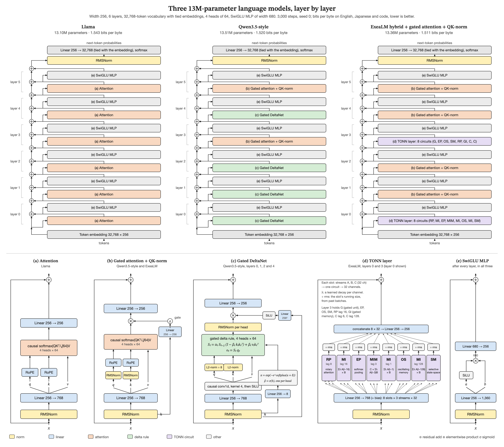

# ExeaLM

[日本語](README.ja.md)

An open language model built by high schoolers, run by [Exea Labs](https://exealabs.org). Code and weights are public under Apache 2.0.

**The idea:** ExeaLM is a 0.1B-parameter (about 100 million) language model, pretrained from scratch on about 100 billion tokens and then post-trained into an assistant, like any other LLM. What's different is the architecture, **TONN**, which builds two new abilities into every layer: **its own RAG**, where the model learns its own embeddings, decides what to search for, and pulls text from a read-only datastore, and **agent-to-agent communication**, where copies of the model post messages to a shared board and read each other's. Both are circuits inside the network, trained end to end like everything else, not tools bolted on afterwards.

**The bet:** a 0.1B model can take on problems far bigger than its size, because it doesn't have to do everything alone. Its knowledge doesn't all have to fit in 100 million weights, because the model looks things up through its own RAG. A large problem doesn't have to fit in one copy's context or skill, because a swarm of copies splits the work and shares what they find through the board. And because both abilities are part of the architecture from the first step of pretraining, the model learns to search and collaborate the way it learns language, not through tools added at the end. This is a hypothesis we are testing, not a result yet. The headline experiment is a swarm of 0.1B agents with retrieval against a single larger model on the same tasks, at the same inference compute.

**Status:** research preview. The 0.1B model is not trained yet. The model code (TONN, the retrieval circuit, the agent-board circuit, the architecture search) runs and is tested, and small models (13M to 18M parameters, and short 0.1B runs) have been trained with it: their checkpoints, the tokenizer and every result file are on [Hugging Face](https://huggingface.co/exea-labs/ExeaLM). The data scripts work on small samples. The pretraining loop, the three post-training loops (SFT, DPO, GRPO) and an lm-evaluation-harness adapter are written and tested on tiny models. Downloading the full data and training at scale are open tasks.

## Join

Fill out the sign-up form so we can list you as a contributor: https://docs.google.com/forms/d/e/1FAIpQLSdPHVZhuXxBDUf-cJM2zDbj1JZPsduu95Y_kTJ_g4gKAXdDVw/viewform

The repo is public, so you can open an issue or pull request without signing up. The form gives us a record of who worked on the project. [CONTRIBUTING.md](CONTRIBUTING.md) explains how to start. Pick something from the [to-do list](#to-do-list): almost all of it runs on a laptop or a free Colab GPU.

## Start in five minutes

```bash
git clone https://github.com/exea-labs/ExeaLM && cd ExeaLM
pip install -e ".[dev,data]"
pytest                                                           # about a minute, CPU is fine

# train a tiny model on made-up data (no download, about 10 seconds on a laptop CPU)
python -m exealm.train.pretrain --preset tiny --data synthetic --steps 300 --datastore_chunks 2000

# the fair comparison: same run with the plain transformer baseline
python -m exealm.train.pretrain --preset tiny --data synthetic --steps 300 --model llama --out runs/llama

# real data: one file of Japanese Wikipedia from the LLM-jp corpus (~320 MB)
python -m exealm.data.download llmjp --subset ja/ja_wiki --max_files 1 --out data/raw
python -m exealm.data.sources                                    # print the two candidate 100B-token mixes
```

Load a research checkpoint from [Hugging Face](https://huggingface.co/exea-labs/ExeaLM) in one line, or write with it in the terminal (`pip install huggingface_hub`). These are base models: they continue text, they do not chat yet.

```python
import exealm
model, tok = exealm.from_pretrained("17m/exealm_together_gated_seed0")
```

```bash
python -m exealm.chat --ckpt 17m/exealm_together_gated_seed0 --raw --swarm 4    # four agents continue your text together
```

New to this? [notebooks/tiny_tour.ipynb](notebooks/tiny_tour.ipynb) is a guided tour that needs no GPU: under 5 minutes on
one CPU thread ([open in Colab](https://colab.research.google.com/github/exea-labs/ExeaLM/blob/main/notebooks/tiny_tour.ipynb)).
Train the `tiny` model, look at its circuits, switch some off, and watch two agents learn to talk over the board.

Full data walkthrough (filter, tokenizer, pack, then train the 18M `small` preset, which fits on a laptop or a free Colab GPU): [docs/data.md](docs/data.md).

## The plan

### 1. Architecture: TONN

TONN is a sequence model that builds its own architecture from data. A normal transformer layer is attention plus an MLP. A TONN layer instead holds 20 small **circuits**, each one of 14 types:
- memories: delays, leaky running sums, gated memories, a Mamba-like selective state space, an oscillating memory
- local and global mixing: short convolutions, rotary attention
- the two new memory circuits, described in sections 2 and 3

After each TONN layer comes a gated MLP, as in a transformer.



*Llama, a Qwen3.5-style model and the ExeaLM hybrid with gated attention and QK-norm, at 13M parameters, as compared in
[results §12](results/README.md). Top: every layer and its residual connections. Bottom: the inside of every block:
(a) attention, (b) gated attention with QK-norm, (c) Gated DeltaNet, (d) a TONN layer with the 8 circuits of its first
TONN layer, (e) the SwiGLU MLP. Drawn by `docs/figures/arch_compare.py`.*

**ExeaLM is a hybrid.** Every third layer is a TONN layer and the others are full attention layers (5 TONN and 9
attention layers in the 0.1B model), and TONN's starting circuits favour short convolutions. The attention layers use
two parts from Qwen3.5: gated attention (a sigmoid gate on each output channel) and QK-norm (RMSNorm on each head's
queries and keys). They improve the hybrid by 0.025 bits per byte at 13M (2 seeds) and by 0.026 in the full 17M model
with both memory skills (1 seed), and they add 4% to the 0.1B model's parameters (105M with the planned vocabulary). Pure TONN lost to a
same-size Llama on real tokens, mostly on code. The hybrid beats it, with both seeds, on every kind of text (bits per
byte, lower is better):

| Model (13M parameters unless marked, 3,000 steps) | English | Japanese wiki | Japanese web | Code |
|---|---|---|---|---|
| Llama-style transformer (2 seeds) | 1.467 | 1.540 | 1.420 | 1.789 |
| Pure TONN (2 seeds) | 1.480 | 1.568 | 1.422 | 1.979 |
| **ExeaLM hybrid (2 seeds)** | **1.452** | **1.521** | **1.404** | **1.746** |
| *27M parameters:* Llama (2 seeds) | 1.446 | 1.523 | 1.402 | 1.778 |
| *27M parameters:* **ExeaLM hybrid (2 seeds)** | **1.412** | **1.483** | **1.371** | **1.702** |
| *48M, same training time:* Llama (2 seeds) | 1.369 | 1.439 | 1.333 | 1.667 |
| *48M, same training time:* **ExeaLM hybrid, 2:1 layout (2 seeds)** | **1.366** | **1.436** | **1.327** | **1.653** |
| *0.1B (90M), same training time:* Llama (1 seed, lr 1e-3) | 1.392 | 1.468 | 1.352 | 1.713 |
| *0.1B (90M), same training time:* **ExeaLM hybrid (1 seed, lr 1e-3)** | **1.373** | **1.451** | **1.339** | **1.692** |

That's small scale and short training. At 6,000 steps the hybrid is still ahead on every kind of text, but by less
(0.006). After the speed work the hybrid costs 1.13 times a Llama per token at 0.1B. Given the same training time on
the same GPU, it ties Llama at 13M and wins at 27M. At 48M the half-attention layout lost (0.014), but the 2:1 layout
(two attention layers per TONN layer) **wins at equal compute at 48M: 1.445 vs 1.452, both seeds, every kind of
text.** That layout is now the default. At 0.1B, with the same training time, it leads Llama on every kind of text on
both seeds (0.007 and 0.010 at its 1.5e-3 rate; 0.017 and 0.031 at Llama's 1e-3). Details:
[results/README.md](results/README.md#8-overnight-sweep-making-tonn-beat-llama-experimentsrun_queuesh-resultssweep).

Nobody picks which circuit goes where. While the model trains, TONN switches each kind of circuit off on text it has not trained on and keeps it only if the error goes up. Useless circuits are replaced by new ones, drawn more often from the kinds that have proven useful. Early in training the architecture changes; later it is frozen.

Paper: [TONN: Networks That Build Their Own Architecture from Data](https://www.preprints.org/manuscript/202611.0994) (Avneh Singh Bhatia, Preprints.org, November 2026). It is a concept paper and has not been peer reviewed. Its larger-scale results are mixed, so we test TONN against a plain transformer at equal compute on small models before any large run.

The language-model evidence so far comes from small tests only: 4.85M parameters, byte-level English web text ([FineWeb-Edu](https://huggingface.co/datasets/HuggingFaceFW/fineweb-edu)), and the same 25 MB of training text for every model.

| Model | Bits per byte (lower is better) |
|---|---|
| Llama-style transformer, same size | 1.813 |
| TONN, seed 0 | **1.738** |
| TONN, seed 1 | 1.766 |
| Transformer, 3× more data (82 MB) | 1.690 |
| TONN, 3× more data (82 MB) | **1.622** |

Caveats:
- TONN currently trains about 2.7 times slower per step, because its kernels aren't optimized yet.
- The seed-to-seed spread is real.
- 4.85M parameters is a long way from 0.1B.

The project's first job is to check that the lead holds at larger scale. Details: [docs/architecture.md](docs/architecture.md).

### 2. Its own RAG (the RG circuit, read-only)

Every layer has at least one **RG** circuit. Once per 64 tokens it:
1. turns what it has read so far into a **query** (each RG circuit learns its own);
2. searches a **read-only datastore** of training-text chunks, using **embeddings made by the model's own encoder** (no outside embedding model);
3. weighs the top results by how well they match;
4. lets each position read the retrieved text with attention.

All of it is learned from the next-token loss. The datastore never returns chunks from the document being read, so the model can't cheat by looking up the answer.

### 3. Agents that talk to each other (the AG circuit, read and write)

Every layer has at least one **AG** circuit, which connects to the **agent board**. Once per 64 tokens (every 8 in the 17M runs, which the relay needs), each copy of the model posts a message: what it is about, what it says, and how strongly it wants it read, so it can stay quiet. At every position it reads the earlier messages of the other agents in its swarm with attention, and it can choose to read nothing. The datastore is read-only; the board is read *and* write. At inference, many running agents can share a persistent board.

**Guaranteed, then chosen:** every layer starts with one RG and one AG circuit, and the search can never remove the last one, because both need training before they become useful. The search is free to add more wherever they earn it. Design and open questions: [docs/memory.md](docs/memory.md).

### 4. Swarms: agents that work together

A **swarm** is a few agents (4 by default) sharing one board. Training runs many swarms at once: each batch is split into swarms, each with a private board, and swarms never hear each other.

- **Pretraining: swarms pull data together.** Each agent reads ordinary training text, so swarms cost no extra data. The swarm is chosen so that what one agent reads helps the others: parts of one long document (built), related documents, or the same topic in Japanese and English (to do). Some swarms are random, so agents also learn when to ignore the board. Each agent also searches the datastore on its own and can share what it finds.
- **Post-training: swarms solve tasks together.** Each agent gets part of the information and one must answer. Because a swarm runs in one forward pass, the answer's loss trains every agent's messages directly. After that, RL rewards the whole swarm for solving split-information questions, divide-and-conquer math, and write-and-test code.

To our knowledge, ExeaLM is the first language model with agent-to-agent communication built into its architecture. Until an experiment shows agents learning to say something useful, that is a design, not a result. Design, rules and open questions: [docs/swarms.md](docs/swarms.md).

### 5. Data: about 100 billion tokens

Selected from open corpora, including:
- **[FineWeb-Edu](https://huggingface.co/datasets/HuggingFaceFW/fineweb-edu)** and **[DCLM-Baseline](https://huggingface.co/datasets/mlfoundations/dclm-baseline-1.0)**: filtered English web text, the largest part of the mix.
- **[NII LLM-jp Corpus v4](https://gitlab.llm-jp.nii.ac.jp/datasets/llm-jp-corpus-v4):** 19.5T tokens in total, including 688B Japanese and 17.8T English, plus code, Chinese and Korean. It downloads without an account.
- **The data released with [K2 Horizon](https://ifm.ai/blog/k2)** (Institute of Foundation Models, [collection](https://huggingface.co/collections/IFM/k2-horizon)): [TxT360-v2](https://huggingface.co/datasets/IFM/TxT360-v2) (web and QA), [Pretrain-Behaviors](https://huggingface.co/datasets/IFM/Pretrain-Behaviors), [Math-Reasoning](https://huggingface.co/datasets/IFM/Math-Reasoning), [Code-Reasoning](https://huggingface.co/datasets/IFM/Code-Reasoning), [SFT-Reasoning](https://huggingface.co/datasets/IFM/SFT-Reasoning).

There are two candidate 100B-token mixes: DATA.md's (English-heavier) and mix proposal v0 (about 21% Japanese). Small ablations decide between them. Every dataset link and license is in [DATA.md](DATA.md) and [docs/data.md](docs/data.md), and both mixes are in [`exealm/data/sources.py`](exealm/data/sources.py).

**Why 100 billion tokens:** extra tokens help less and less. 100B tokens on a 0.1B model is 1,000 tokens per parameter, about 50 times the compute-optimal ratio, on purpose. By the Chinchilla loss fit, predicted loss drops about 0.19 going from 20B to 100B tokens, about 0.06 from 100B to 200B, and about 0.05 from 200B to 400B. Past roughly 200B tokens, extra data buys little. The math is in [DATA.md](DATA.md).

### 6. Training

- **Pretraining:**
  - next-token prediction with a warmup-stable-decay learning rate;
  - the architecture search runs during a pilot run and is then frozen;
  - the retrieval index is refreshed as the model's own encoder learns;
  - the best data is saved for the final decay phase.

  Compute: about 6 × 10¹⁹ FLOPs. That is about 56 MI300X GPU-hours at transformer speed; the default ExeaLM trains at that speed, and retrieval adds about half again (about 85 GPU-hours), so well under a day on 8 GPUs. [docs/training.md](docs/training.md)
- **Post-training,** in this order:
  1. supervised fine-tuning on conversations ([`sft.py`](exealm/train/sft.py));
  2. preference tuning ([`dpo.py`](exealm/train/dpo.py));
  3. reinforcement learning with **GRPO** ([`grpo.py`](exealm/train/grpo.py), the method behind DeepSeek-R1);
  4. **swarm SFT and swarm RL**: swarms share a board and are trained and rewarded together. This is where the AG circuits really learn to talk.
- **Compute:** one central run on cloud compute arranged by Exea. You don't need a GPU to contribute. Weights will be released at https://huggingface.co/exea-labs/ExeaLM.

## Results so far

Same-size models, same data, same steps (3,000 steps, about 49M tokens, one AMD MI300X). Bits per byte on held-out
English, Japanese and code; lower is better. Every seed is in [results/funding/README.md](results/funding/README.md).

| Size | ExeaLM hybrid | ExeaLM hybrid, original starting menu | Llama + gated attention + QK-norm | Qwen3.5-style (our build) | Llama |
|---|---|---|---|---|---|
| 13M | **1.511** (10 seeds) | 1.523 (5 seeds, one weak: 1.567) | 1.522 (10 seeds) | 1.522 (10 seeds) | 1.550 (5 seeds) |
| 0.1B | **1.413** (3 seeds) | 1.427 (3 seeds) | 1.446 (3 seeds) | 1.457 (3 seeds) | 1.509 (3 seeds) |

| Memory skill (chance 1.6%) | With the circuit | With it cut | Where |
|---|---|---|---|
| Relay through the board | 99.8 to 99.9% | at most 2.1% | 0.8M model, 3 seeds |
| Relay through weight edits (`wa_key="hidden"`) | 99.7 to 100% | at most 2.1% | 0.8M model, 6 runs |
| Lookup in a library of 1,024 unseen facts | 94% | 1.6% | 18M model trained mostly on text, 2 seeds |
| Relay and lookup in one 0.1B model | 99.4 to 100% and 75 to 78% | 0.8% and 1.6% | 94.7M, 2 of 5 runs trained |

These are short runs at equal steps. The hybrid takes about 1.2 times as long per step as Llama in 32-bit precision
(1.6 times in bf16). The Qwen3.5-style model is our own small build, not the released weights. No memory circuit has
lowered the loss on ordinary text yet.

- **At 0.1B the hybrid leads every baseline on every seed** (1.413 against 1.446 for a gated Llama and 1.457 for a
  Qwen3.5-style model). Leaving rotary attention out of the starting circuits removed the weak seeds; it is now the
  default.
- **Agents can teach each other by editing weights.** A weight-alter slot emits rank-1 changes to an MLP matrix of
  another agent. With a learned key it passed 52% of the relay facts; with the key taken from the edited layer it
  passes 99.7 to 100%. On ordinary text a self-editing slot costs 0.003 to 0.005 bits per byte.

Earlier small-scale tests on a Mac Studio, all in [results/README.md](results/README.md):
- **Agents learn to talk.** Facts held by one agent reach another only through the board: 99.8% correct with the board,
  1.5% (chance) without, 3 seeds. With 4 agents, one gathers facts from the other three.
- **The model builds its own RAG.** On facts that change every step, it finds the right one among 1,024 it has never
  seen: 100% correct with its datastore, 1.5% (chance) without. It learns its own embeddings, queries and reading.
  The first design never learned; the report says what broke and why. On real text retrieval is not yet a net win:
  with a perfect search it would gain 0.040 bits per token on a Wikipedia knowledge task, but the model's own search
  finds the right article only about 30% of the time.
- **One 18M model learns both memory skills alongside text.** Trained mostly on real text, it passes facts between
  agents through its board (100% correct, 1% with the board cut) and looks up facts in a library it has never seen
  (94%, 1.6% without it), on both seeds, once the two skills are taught together from the first step. On language it
  is about even with a same-size Llama: 0.011 bits per byte ahead at equal steps over two seeds, a tie at equal
  compute ([results §10](results/README.md#10-the-whole-model-at-17m-with-the-board-and-the-library-on-experimentsfull_smallpy-resultsfull_small)).
  Gated attention and QK-norm from Qwen3.5 improve it by 0.026 (1.393 against 1.419, one seed), and it keeps both
  skills. The circuit search over a full run adds board circuits and costs 0.012 on language.
- **Memory on real text does not pay off yet** ([#27](https://github.com/exea-labs/ExeaLM/issues/27)). On held-out
  Wikipedia, with the first half of each article as knowledge the model never trained on, the library, a live second
  agent and notes written ahead of time each change the loss on re-mentioned rare words by -0.10 to +0.01 bits.
  Putting that first half in the context instead gains about 1 bit, and ordinary BM25 RAG 0.34. Practice on real
  text makes the library harmless but not helpful. Notes from a reader of the article gain up to 0.039 bits. After
  8,000 steps of practice, notes from all 256 articles at once make it 7.9 bits worse, so the board must learn to
  ignore notes on the wrong article ([results §13](results/README.md#13-memory-on-real-text-experimentsirl_evalpy-resultsirl-issue-27)).
- **The swarm gain on real text did not reproduce.** We reported 0.014 bits per byte for swarms over a matched
  control (0.012 after a leak found in PR #7). Reruns range from 0.015 better to 0.035 worse than the control, and
  the same run twice differs by up to 0.012 on the Mac's GPU. Treat it as unproven until more seeds give a number
  with a spread ([#33](https://github.com/exea-labs/ExeaLM/issues/33), [results §2](results/README.md#2-swarms-on-real-text-experimentsswarm_textpy)).
- **Tokenizer: 32k.** It wins or ties 49k and 64k on English, Japanese and code at a fixed token budget.
- **Speed:** the default 0.1B model (2:1 hybrid) trains at the same speed as a same-size Llama (1.01x per token), 1.49x with retrieval on.
- **Pure TONN lost to Llama on real tokens; the hybrid wins.** Pure TONN trailed a same-size Llama, mostly on code. A
  hybrid (TONN layers among attention layers, convolution-heavy start) beats Llama on English, Japanese and code
  with both seeds: at equal size and steps (13M, 27M, 48M) and, with two attention layers per TONN layer, at equal
  training time at 48M (0.007 bits per byte) and at 0.1B (0.024 at lr 1e-3, both seeds, short runs without memory
  circuits). That is now the default architecture.

## To-do list

Starting points. Almost everything here runs on a laptop or a free Google Colab GPU, using the `tiny` preset or the 18M-parameter `small` preset. Items marked **(starter)** are good first tasks. Items marked **(GPU)** need bigger GPUs: maintainers run those on Exea's compute, and you can still write and test the code on a small model. Many items are GitHub issues with details and a definition of done: [good first issues](https://github.com/exea-labs/ExeaLM/issues?q=is%3Aopen+label%3A%22good+first+issue%22) and [help wanted](https://github.com/exea-labs/ExeaLM/issues?q=is%3Aopen+label%3A%22help+wanted%22). To claim an item, comment on its issue, say so in #exealm, or open a draft pull request. Anything that changes the model or the training has to win a fair small-scale comparison first ([CONTRIBUTING.md](CONTRIBUTING.md)).

### Swarms and agents (`exealm/model/board.py`, `exealm/data/loader.py`, [docs/swarms.md](docs/swarms.md))
- [x] Proof of mechanism: agents learn to pass facts over the board during training, 99.8% vs 1.5% with the board cut ([results](results/README.md#1-agents-learn-to-talk-through-the-board-during-training-experimentsswarm_relaypy))
- [x] First real-text experiment: split swarms beat a matched control by 0.006 bits per byte at 5M parameters; split batches cost 0.021 ([results](results/README.md#2-swarms-on-real-text-experimentsswarm_textpy))
- [ ] Is the swarm gain on real text real? Reruns range from 0.015 better to 0.035 worse than the control, and the same run twice differs by up to 0.012; it needs 3 more seeds in both seam settings ([#33](https://github.com/exea-labs/ExeaLM/issues/33))
- [x] One model with both skills: the 17M model learns the relay and lookup alongside text when both are taught together from step 0 ([#26](https://github.com/exea-labs/ExeaLM/issues/26))
- [x] The board on real text: pair batches (a reader of one half of an article, heard from the first token by an agent reading the other half), scored with `experiments/irl_eval.py`. Notes from a reader of the article gain up to 0.039 bits; after longer practice, notes from all 256 articles at once break the model ([#27](https://github.com/exea-labs/ExeaLM/issues/27), [results §13](results/README.md#13-memory-on-real-text-experimentsirl_evalpy-resultsirl-issue-27))
- [ ] A notes knowledge base at scale: search the stored notes instead of attending to all of them ([#28](https://github.com/exea-labs/ExeaLM/issues/28))
- [ ] Swarm batches that keep as many independent stretches of text as solo batches (the 0.021 cost above) ([#19](https://github.com/exea-labs/ExeaLM/issues/19))
- [x] (starter) Measure board use during training: AG worth in the search log, how often agents read nothing, post strength (`board` in eval records, `board_worth` in search records)
- [ ] Related swarms: group documents that are near each other in the model's own retrieval space
- [ ] Cross-lingual swarms: pair Japanese and English Wikipedia articles on the same topic (interlanguage links) ([#23](https://github.com/exea-labs/ExeaLM/issues/23))
- [ ] Swarm sizes that vary within a run (2 to 8)
- [x] A weight-alter circuit (`WA`, `exealm/model/alter.py`, opt-in): a slot that emits rank-1 changes to an MLP weight matrix of its own agent or of the other agents in its swarm, learned from the ordinary loss; the changes last for one pass ([docs/memory.md](docs/memory.md))
- [ ] Weight changes that persist across passes (a store like the persistent board), and a safety review before any edit reaches stored parameters
- [x] Weight-edit capacity on the synthetic relay: hidden-key WA carries all 64 facts on both seeds, while the board averages 87.2% at 32 facts and stays near chance at 64 after the same 3,000 steps ([#58](https://github.com/exea-labs/ExeaLM/issues/58), [results](results/swarm_relay_capacity/README.md))
- [ ] Weight-alter with 4 agents (three writers editing one reader) and with a later layer as the target (`wa_target`)
- [ ] In the combined 0.1B model with `wa_key="hidden"` the relay went through weight edits alone and the board was unused (1 seed). Does that hold on more seeds, and does the board come back when the facts are longer than one chunk?
- [ ] A relay built from real text (one agent reads a paragraph, another answers about it), to compare the board and weight-alter outside the toy task
- [x] Agent identity: opt-in learned author signals on board posts ([usage](docs/memory.md#agent-identity))
- [ ] Retrieval division of labor: do agents in a swarm pull different chunks? Try rewarding it
- [ ] Swarm-aware multi-GPU training, keeping each swarm on one GPU (testable on a CPU with two processes)
- [ ] Swarm SFT data: split-information tasks built from multi-hop QA. This also fills the "tool use and agentic" gap in [DATA.md](DATA.md)
- [ ] Swarm SFT loop: loss on the answering agent, trained through the board (test on the `tiny` preset)
- [ ] Swarm RL (GRPO): whole-swarm attempts with a shared reward (test on the `tiny` preset)
- [ ] Swarm task suite: split-information QA, divide-and-conquer math, write-and-test code, propose-and-check, cross-lingual QA
- [x] Swarm generation: all agents generate in lockstep in one batch (`exealm/generate.py`: one new token per agent per step, each agent stops on its own, the swarm shares the in-batch board)
- [x] Board server so agents on different machines share one board (HTTP: `python -m exealm.memory.board_server`, `RemoteAgentBoard`; [docs/memory.md](docs/memory.md), [#35](https://github.com/exea-labs/ExeaLM/issues/35)). One server process, boards live in memory
- [ ] Message decoder: turn board messages into text people can read ([#34](https://github.com/exea-labs/ExeaLM/issues/34))
- [ ] Safety: agents treat other agents' messages as information, not instructions (data and an eval)
- [ ] Swarm eval: the same tasks solo vs swarms of 2, 4 and 8
- [ ] Headline eval: a swarm of 0.1B agents with retrieval vs a single larger open model (for example 1B) on the same large tasks at the same inference compute. Build and test the harness now on `tiny` checkpoints and small open models

### Retrieval (`exealm/model/retrieval.py`, `exealm/memory/datastore.py`)
- [x] FAISS (IVF-PQ) index for the datastore (`exealm/memory/faiss.py`, optional, exact search stays the default; on 1M random keys 16 subquantizers and 32 probes find 85% of the exact top 4 and are faster than exact search, [results/faiss_datastore](results/faiss_datastore/README.md), [#15](https://github.com/exea-labs/ExeaLM/issues/15))
- [ ] Compare FAISS against exact search on real retrieval keys and on the model's loss before using it in a run
- [ ] Choose what goes in the datastore: a curated few billion tokens of reference text
- [ ] Re-indexing schedule: how stale can the stored keys get? (`small` preset)
- [ ] Cheaper retrieval: cache encodings, share retrievals across layers, tune top-k and chunk length
- [ ] Key size: 32 vs 64 vs 128 numbers (`small` preset)
- [x] (starter) Script that prints what RG retrieved for a prompt (`python -m exealm.eval.show_retrieval`)
- [x] Swap the datastore at inference: on synthetic facts the model never saw, 94% correct with a fresh library (two seeds, 17M)
- [ ] The same on real text: a library of documents the model never trained on ([#27](https://github.com/exea-labs/ExeaLM/issues/27)); training the read on the right real document (`--wiki_oracle`) makes the library harmless but not helpful
- [x] Ordinary RAG baseline for the real-text test: BM25 and the retrieved text in the prompt gains 0.34 bits on re-mentions; the right article in context 1.0 ([#32](https://github.com/exea-labs/ExeaLM/issues/32))
- [ ] Make retrieval pay off on real text. A perfect search would gain 0.040 bits per token on a Wikipedia knowledge task. Rare-word codes in the keys raise the search's hit rate from 12% to 30%, but the net gain over a no-retrieval model is not yet established (+0.026 and -0.002 on two seeds; results §6). Next: better pooling, hard negatives, a bigger encoder, larger models ([#22](https://github.com/exea-labs/ExeaLM/issues/22))

### Architecture (`exealm/model/`)
- [x] TONN vs Llama with the `small` preset on real tokens, two seeds each: Llama ahead, most of all on code ([results](results/README.md#7-tonn-vs-llama-on-real-tokens-experimentstokenizer_lmpy---models-))
- [x] Close the gap: TONN layers alternating with attention layers, with a convolution-heavy start, beat Llama at equal size and steps (13M, 27M) and at equal compute at 27M ([results](results/README.md#8-overnight-sweep-making-tonn-beat-llama-experimentsrun_queuesh-resultssweep))
- [x] Confirm the hybrid's equal-compute lead at 48M (1.445 against 1.452, both seeds), then at 0.1B (0.024 at 1e-3, both seeds; short runs without memory circuits)
- [x] Hybrid layout: at equal steps the number of attention layers barely matters (13M, 2 seeds); at equal compute two attention layers per TONN layer win (48M), now the default
- [x] Re-run the swarm and retrieval experiments on the hybrid (they ran on pure TONN)
- [ ] Ablations at `small` size: with and without RG, AG and swarms
- [x] Gated DeltaNet, Qwen3.5's linear attention, as a layer (`exealm/model/delta.py`, tested against the recurrence); gated attention and QK-norm as options. At 13M (one seed) gated attention + QK-norm improve the hybrid by 0.025 bits per byte and put it ahead of a Qwen3.5-style model; DeltaNet layers add nothing on top ([results §12](results/README.md))
- [x] Make gated attention + QK-norm the default: it holds on two seeds (1.511, 1.512), beats a gated Llama and a Qwen3.5-style model at equal steps and at equal compute (1.509 against 1.515 and 1.542), and improves the full 17M model with both skills (1.393 against 1.419) ([results §10, §12](results/README.md#12-parts-from-qwen35-exealmmodeldeltapy-experimentstokenizer_lmpy---llama_cfg))
- [ ] The full 17M model against a gated Llama on the same batches (the fair baseline now that ExeaLM is gated)
- [ ] Gated DeltaNet as a TONN circuit type the search can choose ([#30](https://github.com/exea-labs/ExeaLM/issues/30)); other new types, for example sliding-window attention
- [x] A circuit that has not been measured yet was scaled by the batch it was reading, so its output depended on later tokens and on other rows until its first training step. Fixed in [#47](https://github.com/exea-labs/ExeaLM/pull/47) (a constant scale until the first measurement). On real text at 13M the fix changes the score by 0.0001 bits per byte (3 seeds, [results/funding](results/funding/README.md))
- [x] The starting menu without rotary attention is the default for the hybrid (`HYBRID` in `exealm/config.py`; the search can still add the type). It scored 1.511 over 10 seeds at 13M (Qwen3.5-style 1.522, gated Llama 1.522) and 1.413 over 3 seeds at 0.1B (original menu 1.427, gated Llama 1.446, Qwen3.5-style 1.457)
- [ ] (GPU) The same comparison at equal training time in bf16, where the hybrid is 1.6 times slower per step than Llama at 0.1B: does the 0.033 lead over the gated Llama survive? The queue for this and the next three GPU items is ready to run: [experiments/gpu_session](experiments/gpu_session/README.md)
- [ ] (GPU) Longer runs: do the 0.1B leads hold at 10 times the tokens (about 500M)?
- [ ] (GPU) Scale up: 0.5B, 1B and 3B with the same comparison, to see how the lead changes with size
- [ ] Which other circuit types hurt or help in the starting menu? Leave one type out at a time at 13M, 3 seeds each (Colab-sized) ([#59](https://github.com/exea-labs/ExeaLM/issues/59))
- [x] Weight-alter passed about half of what the board passes on the relay (52% against 99.8%), because the model did not learn to tie values to keys. With the key taken from the edited layer (`wa_key="hidden"`) it passes 99.7 to 100% (6 runs)
- [x] Weight-alter with `wa_key="hidden"` on real text and in the combined model: it costs 0.003 to 0.005 bits per byte at 13M (3 seeds); in the combined 0.1B model it carries the relay alone (100%, 1 seed)
- [ ] The combined 0.1B recipe (text with relay and lookup batches) trained in 2 of 5 ExeaLM runs. The logs only held one line per 1,000 steps, so the cause is unknown. `experiments/full_small.py` now prints the loss of each kind of batch and the gradient norm every 100 steps (`--log_every`) and can grow the lookup datastore only once the current size is learned (`--grow_when`). Both are untested on real data: **(GPU)** rerun the five settings with them and find where the failed runs leave the good ones
- [ ] Shape sweep at fixed parameters: depth, width, slots per layer, channels per slot
- [ ] Search schedule: how long to search, how much to replace, how long new circuits are protected (on the hybrid with a good start it adds about 0.001 today)
- [ ] The search did not repair a weak start: on the weak seed at 13M it replaced one circuit in the whole run (1.565 against 1.567). Make it replace more when the worth scores say a type is useless, and test on seeds 4 and 6 of `results/funding`
- [ ] Which circuit types survive the search, and does that change from `tiny` to `small`?
- [x] (starter) Plot the architecture the search chose, layer by layer, over training: `experiments/plot_search.py` ([figure and results](results/README.md#11-what-the-search-chooses-experimentsplot_searchpy-resultssearch_arch), [#11](https://github.com/exea-labs/ExeaLM/issues/11))
- [x] (GPU) Confirm the winners at the full 0.1B size: 3 seeds each at equal steps, hybrid 1.413 (1.427 with the original menu), gated Llama 1.446, Qwen3.5-style 1.457, Llama 1.509 ([results/funding](results/funding/README.md))

### Speed (`exealm/model/scan.py`)
- [ ] Fused Triton kernels for `decay_scan` and `gated_scan` (any NVIDIA GPU works, including a free Colab T4; must also run on AMD MI300X) ([#16](https://github.com/exea-labs/ExeaLM/issues/16))
- [ ] A compile-friendly TONN layer: one code path for every circuit type, so `torch.compile` can fuse it (today it gains 8% for the hybrid and 20% for Llama) ([#24](https://github.com/exea-labs/ExeaLM/issues/24))
- [ ] One scan call for all running-sum circuits in a layer
- [ ] Profile where the memory circuits' time goes: the 17M model with the board and library on is 1.30x Llama per step ([#29](https://github.com/exea-labs/ExeaLM/issues/29))
- [ ] In bf16 on the MI300X the hybrid is 1.6 times slower per step than Llama at 0.1B and 0.5B (1.2 times in 32-bit). Find which circuits lose the most from bf16 and fix them ([throughput](results/funding/README.md))
- [ ] Fast Gated DeltaNet on NVIDIA through flash-linear-attention ([#31](https://github.com/exea-labs/ExeaLM/issues/31))
- [ ] Recurrent state cache, so generating a token doesn't re-read the whole context
- [ ] `torch.compile` support
- [x] Training-speed benchmark: the default 2:1 hybrid costs 1.01x a same-size Llama per token, 1.49x with retrieval on (pure TONN was 1.5x) ([results](results/README.md#5-speed-of-the-real-model-experimentsspeedpy), `experiments/speed.py`)
- [x] (starter) Generation speed: `python -m exealm.eval.speed` times training and generation tokens per second against a same-size Llama
- [ ] (GPU) Run the tests and a short training run on an MI300X and report what breaks

### Data ([DATA.md](DATA.md), `exealm/data/`)
- [ ] Download and stage every DATA.md source: parallel, resumable, checksummed (build and test it on samples)
- [ ] (starter) Count tokens in each K2 Horizon subset (streams, no big download) ([#8](https://github.com/exea-labs/ExeaLM/issues/8))
- [x] (starter) A checked formatter for each of the 24 K2 Horizon pretraining and SFT subsets (`exealm/data/formatters.py`: broken rows are dropped instead of turned into text from their metadata; [#9](https://github.com/exea-labs/ExeaLM/issues/9))
- [ ] Loader for the K2 guru-RL tasks and rewards (the part of [#9](https://github.com/exea-labs/ExeaLM/issues/9) still open)
- [x] Remove near-duplicates across all sources (MinHash LSH, runs on a CPU): `python -m exealm.data.dedup`
- [ ] Decontaminate against every benchmark we report ([#20](https://github.com/exea-labs/ExeaLM/issues/20)). Built: the held-out text of seven benchmarks exported with its dataset revision (`exealm/data/benchmarks.py`) and a filter that drops packed documents sharing a 13-token run with it (`exealm/data/decontam.py`). The filter hashes every window in numpy and compares exactly only where a hash matches: about 4M training tokens per second on one laptop core (random tokens, 3M benchmark tokens), so 100B tokens is about 7 core-hours, split across sources. Left: run it on the real mix
- [ ] Filter personal data and toxicity
- [ ] Quality classifier for Japanese web text (small classifier, Colab-sized) ([#25](https://github.com/exea-labs/ExeaLM/issues/25))
- [ ] Mix ablations: three or four versions of the mix with the `small` preset; the best two get confirmed at 0.1B **(GPU)**
- [x] Loader with per-source weights over many shard files (`ShardSet`, `MultiShards` and `open_data` in `loader.py`; `--data mix.json` in pretraining). Token files are memory-mapped on first use and only a few stay open
- [ ] (starter) Data card: every source, license, filter and token count ([#10](https://github.com/exea-labs/ExeaLM/issues/10))

### Tokenizer (`exealm/data/tokenizer.py`)
- [x] Train 32k, 49k and 64k candidates and compare them by bytes per token and small-model loss: 32k wins or ties ([results](results/README.md#4-tokenizer-size-experimentstokenizer_comparepy-experimentstokenizer_lmpy))
- [ ] Re-check 32k against 49k on a bigger model, then publish the tokenizer on Hugging Face
- [ ] Final special tokens: chat roles, agent roles, board

### Training (`exealm/train/pretrain.py`)
- [ ] Multi-GPU: DDP, then FSDP (DDP is testable on a CPU with two processes) ([#17](https://github.com/exea-labs/ExeaLM/issues/17))
- [x] Exact resume from checkpoints (`--save_every`, `--stop_at`, `--resume auto`)
- [x] Weights & Biases logging (`--wandb PROJECT` in `exealm.train.pretrain`; a resumed run continues the same W&B run)
- [ ] Context extension near the end of training
- [ ] Optimizer: Muon vs AdamW (`small` preset) ([#21](https://github.com/exea-labs/ExeaLM/issues/21))
- [ ] Multi-token prediction heads (`small` preset)
- [ ] Learning-rate transfer from small models (μP): tune on `tiny`/`small`, carry over to 0.1B
- [x] (starter) Budget sheet: GPU-hours per run, checkpoint cadence, what we can afford ([docs/budget.md](docs/budget.md))

### Post-training (`exealm/train/`)
- [x] SFT loop and data loader (`python -m exealm.train.sft --ckpt ... --data conversations.jsonl.gz`): one conversation per row, padded on the right and grouped by length, so conversations cannot see each other. Tested on `tiny`: it learns a toy question-answer task and answers through the chat demo
- [x] SFT, preference and RL-task data formatters (`python -m exealm.data.post --list`): eight open sources turned into the files the three loops read, each with its license and the revision it was checked at. Checked on 100 live rows per source ([results/post_data](results/post_data/live_check.json)); IFM/SFT-Reasoning cannot be split into turns and stays pretraining text
- [ ] Build the SFT mix at the DATA.md shares (the math and code reasoning sets and WildChat are not formatted yet) and count its tokens
- [x] DPO loop (`python -m exealm.train.dpo --ckpt ... --data prefs.jsonl.gz`): a frozen copy of the starting model is the reference; one row per answer, as in SFT. Tested on `tiny`: it learns to prefer the chosen answers
- [x] DPO data: three English preference sets formatted (`tulu3-pref`, `dolci-pref`, `ultrafeedback` in `exealm/data/post.py`)
- [ ] Japanese preference pairs: no open set found yet
- [x] GRPO loop with math and code rewards (`python -m exealm.train.grpo --ckpt ... --data tasks.jsonl.gz`): samples a group of answers per task, scores them, and updates against a frozen reference. Rewards: `math` (boxed answer or last number), `exact`, and `code` (runs the answer with test code; refused without `--allow_code_exec`). Tested on `tiny`: it fixes a model whose most likely answer was wrong
- [ ] Rewards for instruction-following constraints (RLVR) and for Japanese tasks; a real sandbox for the code reward
- [x] Chat template (`exealm/chat.py`: `chat_prompt` and the same format as a Jinja template, tested to give the same tokens)
- [ ] Do long reasoning traces help a model this small? Test on an existing small open model such as SmolLM2-135M (Colab)

### Evals (`exealm/eval/`)
- [x] (starter) lm-evaluation-harness wrapper (`python -m exealm.eval.harness --ckpt ... --tasks hellaswag`; [docs/evaluation.md](docs/evaluation.md), [#12](https://github.com/exea-labs/ExeaLM/issues/12)). Solo, greedy, no chat template yet
- [ ] Japanese evals (llm-jp-eval)
- [x] Retrieval eval: answers that are in the library but not in the prompt (`experiments/irl_eval.py`: re-mentioned rare words of held-out Wikipedia, bits, top-1 and four choices) ([#18](https://github.com/exea-labs/ExeaLM/issues/18))
- [x] Run evals automatically on every checkpoint (`python -m exealm.eval.auto --run <run folder> --tasks hellaswag --watch 300`: scores each checkpoint once, beside training, into `evals.jsonl` and a table in `evals.md`)
- [x] Results table in this README (under [Results so far](#results-so-far))

### Release, docs and community
- [x] Hugging Face model card and a loader, so the model loads with one line (`exealm.from_pretrained("17m/exealm_together_gated_seed0")`, `exealm/hub.py`)
- [x] Demo: chat with one agent or a swarm (`python -m exealm.chat`; `--raw` continues text, which is what today's base checkpoints can do)
- [ ] Put the demo on the web (a Hugging Face Space) once a checkpoint has been through post-training
- [x] (starter) Diagrams: a TONN layer, RG, AG, a swarm (interactive, on the blog: https://blog.exealabs.org/architecture/)
- [x] (starter) Japanese translation of this README ([README.ja.md](README.ja.md), [#13](https://github.com/exea-labs/ExeaLM/issues/13)). It needs a native reader's review, and it has to follow this file when the to-do list changes
- [x] (starter) Glossary of terms ([docs/glossary.md](docs/glossary.md))
- [x] (starter) Beginner notebook: train the `tiny` model and look inside it ([notebooks/tiny_tour.ipynb](notebooks/tiny_tour.ipynb), [open in Colab](https://colab.research.google.com/github/exea-labs/ExeaLM/blob/main/notebooks/tiny_tour.ipynb), [#14](https://github.com/exea-labs/ExeaLM/issues/14))
- [ ] Technical report

## Repo layout

```
exealm/
  config.py              model sizes: "100m" (the real one, 105M parameters), "small" (18M, laptop/Colab), "tiny" (tests)
  model/
    tonn.py              the TONN layer and the full model
    circuits.py          the circuit menu
    retrieval.py         RG: the model's own RAG engine
    board.py             AG: the agent-board circuit
    search.py            worth measurement and circuit replacement
    scan.py              the running-sum recurrences (needs a fast kernel)
    baseline.py          Llama-style transformer to compare against
  memory/
    datastore.py         read-only retrieval datastore (faiss.py: optional approximate search)
    board.py             persistent read-write agent board (board_server.py, board_http.py: shared over HTTP)
  generate.py            lockstep generation for one agent or a swarm
  chat.py                chat template and terminal demo
  hub.py                 from_pretrained: load a checkpoint from a file or from Hugging Face
  data/                  sources + licenses, download, K2 formatters, quality filters, tokenizer, packing, swarm batches,
                         benchmark exports and decontamination
  train/                 pretrain, sft, dpo, grpo
  eval/                  evaluation plan, lm-evaluation-harness adapter, retrieval and swarm evals
docs/                    architecture, memory (RAG + agents), swarms, data, training, ideas
experiments/             one script per experiment (swarm relay, swarms on text, RAG lookup, RAG on text,
                         tokenizer, TONN vs Llama, speed)
results/                 what they found: results/README.md, plus the raw JSON and logs
notebooks/               tiny_tour.ipynb: a guided tour of the tiny model for new contributors (Colab, CPU)
tests/                   run with pytest
```

## Roadmap

1. [x] Skeleton: TONN model with RG and AG circuits, architecture search, training script, tests
2. [ ] Data pipeline: download, dedupe, filter, and mix the 100B tokens
3. [ ] Tokenizer
4. [x] Small-scale architecture experiments: TONN vs Llama from 10M to 100M parameters (the hybrid leads at 13M and 0.1B; the ablations with and without RG, AG and swarms are still open)
5. [ ] Fast kernels and multi-GPU training
6. [ ] Evaluation harness (English and Japanese, retrieval, agents)
7. [ ] Full training run
8. [ ] Post-training (SFT, DPO, GRPO, swarm training) and release

Each phase gets an owner. Open tasks are in the [to-do list](#to-do-list).

## Community

Read the [Code of Conduct](CODE_OF_CONDUCT.md) before contributing. Contributors are listed in [CONTRIBUTORS.md](CONTRIBUTORS.md). Questions go in #exealm on the Exea Discord.

## License

Apache 2.0. See [LICENSE](LICENSE). Training data keeps its own licenses, listed per source in [`exealm/data/sources.py`](exealm/data/sources.py).
