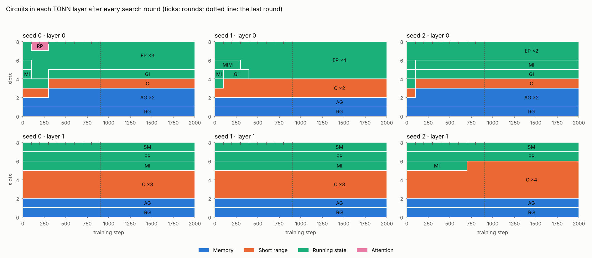

# Results

Experiments run on a Mac Studio (Apple M3 Ultra) on 2026-11-11. Each section names the script that reproduces it.
Raw numbers are in the JSON files next to this page. Everything here is small-scale: these results test mechanisms,
not the final model.

## 1. Agents learn to talk through the board, during training (`experiments/swarm_relay.py`)

**Task.** The information is split across a swarm. Fact holders read `[FACT, key, value]` chunks. The asker reads
questions `[ASK, key, ?]` about those facts, and only the asker is scored. Values are random for every example, so
the asker can beat chance (1 in 64) only if the others pass the facts over the board. The fact holders get no loss of
their own: what they post is learned entirely from the asker's errors flowing back through the board.

**Model.** TONN, width 128, 4 layers, 8 circuits per layer, one AG circuit per layer, 3,000 to 4,000 steps.

| Setup | Trained as | Accuracy, board shared | Accuracy, board cut |
|---|---|---|---|
| 2 agents, 4 facts, seed 0 | swarm | **99.8%** | 1.5% |
| 2 agents, 4 facts, seed 1 | swarm | **99.8%** | 1.8% |
| 2 agents, 4 facts, seed 2 | swarm | **99.9%** | 1.4% |
| 2 agents, 4 facts, seeds 0-2 | solo (control) | 1.4-2.2% | 1.4-2.2% |
| 4 agents: 3 hold 4 facts each, 1 asks about all 12 | swarm | **99.8%** | 1.5% |
| 4 agents (control) | solo | 1.8% | 1.8% |
| 2 agents, 16 facts | swarm | **99.9%** (step 3,000) | 1.5% |

Chance is 1.6%. All three seeds pass 98% within 500-750 steps.

**What it shows.**
- The AG circuit is a working, trainable communication channel.
- Agents learn to post useful messages and to read the right one, end to end, with ordinary gradients.
- One agent can gather facts from three others at once.
- The board carries 16 separate facts per agent.

**What it doesn't show.** That this helps on real text or real problems. That's the point of the next sections.

## 2. Swarms on real text (`experiments/swarm_text.py`)

**Setup.** FineWeb-Edu as raw bytes (400 MB, document boundaries kept). TONN with 5.2M parameters (width 256, 6
layers). 4,000 steps of 32 sequences × 512 bytes, the same bytes per agent in every arm.

The swarm arms read in swarms of 4. In a **split** swarm, 4 agents read 4 consecutive windows of one stretch of text.
All arms are scored on the same held-out split swarms.

| Trained as | Bits per byte, board shared | Bits per byte, board cut | What the board adds |
|---|---|---|---|
| solo | 1.629 | **1.593** | -0.037 (it never learned to use a board) |
| split swarms | **1.607** | 1.612 | +0.005 |
| mixed (half split, half random) | **1.606** | 1.607 | +0.001 |
| split batches, board cut while training (control) | 1.631 | **1.613** | -0.018 |

**What it shows.** Each model is compared in the mode it was trained in.

| Comparison | Bits per byte |
|---|---|
| Split swarms (board shared) vs the same batches with the board cut while training (control) | 1.607 vs 1.613: **the board gains 0.006** (0.4%) |
| The control vs ordinary solo training | 1.613 vs 1.593: **split batches cost 0.021** |

- On real text at this size, agents gain a little from each other, and the gain is about the same at every position
  in the swarm.
- The overall deficit against solo training comes from the batches, not the board: a split batch holds 4 times fewer
  independent stretches of text.
- In pretraining, swarms should either keep the number of independent stretches up (more rows per batch) or read
  different documents (related swarms) instead of one stretch.

**On the hybrid** (the default architecture, `results/swarm_text_hybrid/`, 2 seeds):

| Trained as | Seed | Bits per byte, board shared | Bits per byte, board cut |
|---|---|---|---|
| Split swarms | 0 | **1.623** | 1.627 |
| Split swarms | 1 | **1.622** | 1.626 |
| Split batches, board cut while training (control) | 0 | | 1.639 |
| Split batches, board cut while training (control) | 1 | | 1.634 |

- **Swarms beat the matched control by 0.014 bits per byte on average** (0.015 and 0.012 on the two seeds, about 0.8%),
  more than twice the gain on pure TONN.
- Every position in the swarm gains.
- The swarm-trained model is better than the control even with its board cut, by 0.010 on average: training as a swarm
  improves each agent on its own, beyond what it reads from the board.

**Correction (2026-11-11, found by @aarochu in PR #7): a target leaked through the board in split swarms.** In a split
swarm, agent i's last target is the first token agent i+1 reads, and agent i+1's first board post (the mean of its
first chunk) is readable by agent i in its last chunk. One target in 512 per agent, for agents 1 to 3, could be read
off the board; the matched control (swarm size 1) could not do this.
- How much it can explain: at most about 0.002 bits per byte of the 0.014 (all of the seam byte given away), and about
  0.001 by the data: agents 1 to 3 gain about 0.001 more from the board than agent 4, which has no seam.
- What holds without it: agent 4 alone beats the control by 0.012 (seed 0) and 0.009 (seed 1). The board-cut gain
  (0.010) is not exposed at evaluation.
- The pure-TONN gain above (0.006) is the most exposed: the same ceiling of 0.002 is a third of it.
- The loader now hides seam targets in split swarms (`mask_seams`), and `experiments/swarm_text.py` scores only the
  targets it keeps. Both swarm experiments are queued to rerun with the fix; the numbers above stay as measured until
  then.

Next steps toward the bet (a 0.1B model that takes on large problems with its swarm):
- swarms of related documents instead of consecutive windows;
- tasks that need collaboration (post-training);
- larger models.

## 3. The model builds its own RAG (`experiments/rag_lookup.py`)

**Task.** A datastore of facts `[FACT, k1, k2, value]` with two-token keys and values drawn fresh every training step,
so they can't be memorized in the weights. The model reads questions `[ASK, k1, k2]`, and in the next chunk must give
the answer `[ANS, value]`, scored only on the value. Chance is 1 in 64. To beat it, the model has to learn all of RAG
on its own:
- its own embeddings for the datastore;
- what to search for;
- which result to trust;
- how to read the answer out of it.

In the "restated" variant the answer chunk repeats the key before the value. In the original variant the model must
also carry the key over from the question chunk.

**Model.** TONN, width 128, 4 layers, 8 circuits per layer, one RG circuit per layer, top-4 retrieval. 4,000 steps.
For the 1,024-fact run the training datastore starts at 16 facts and doubles every 400 steps.

| Datastore at evaluation | Variant | Datastore attached | Datastore removed | Same model trained without a datastore |
|---|---|---|---|---|
| **1,024 facts** | original | **100.0%** | 1.5% | 2.3% |
| 16 facts | original | **100.0%** | 0.9% | 0.8% |
| 16 facts | restated | **100.0%** | 1.6% | 2.1% |
| 4 facts | restated | **100.0%** | 0.1% | 10.2% |
| 4 facts | original | **88.4%** | 4.2% | 5.4% |

Chance is 1.6%. In the 4-fact restated run the control reaches 10%: with only 4 facts, later questions can copy an
earlier answer from the model's own text. The 1,024-fact model reached 93% by step 1,000 and 99.6% by step 2,000.

**What it shows.** RG works as designed. It's a trainable RAG engine the model builds itself, and it finds the right
fact among 1,024 it has never seen.

**How we got here.** The first design never learned: accuracy stayed at chance for 4,000 steps. Diagnosis on small
cases found three separate blockers. Each would have been enough on its own.

1. **The query and the stored keys lived in unrelated spaces.** The search was no better than random. Fix: the query
   for chunk c is the same encoder applied to chunk c-1, plus a learned contribution from the circuit's own stream
   (starting at 0). Both sides go through the same encoder.
2. **An output gate scrambled the retrieved value.** The read was multiplied by a gate computed from the reading
   position. A linear probe recovered the value from the read 68% of the time before the gate and 2.5% after it.
   Fix: no gate.
3. **A zero-initialised matrix swamped the retrieved tokens' identity.** It added the encoder's in-chunk states to each
   retrieved token, and Adam moves every entry of a zero matrix by about the learning rate per step whatever the
   gradient, so within 100 steps it drowned out the token identity the match relies on. Fix: retrieved tokens are
   plain token embeddings, read through the layer's own input projection.

Two smaller choices helped:
- the retrieval keys look one token back, so "find the key, take what follows it" is one attention step;
- the weighting of retrieved chunks starts soft.

Controls along the way:
- The same model learned the same lookup with the facts in its own context (95% in 1,000 steps), so the model could
  do the task. The failure was in retrieval.
- With two fixed datastores the broken design could still fit answers that differ only in the datastore, so
  gradients were flowing.

**What it doesn't show yet.** Whether retrieval helps on real text. That's section 6.

## 4. Tokenizer size (`experiments/tokenizer_compare.py`, `experiments/tokenizer_lm.py`)

Byte-level BPE trained on the same sample: 200 MB English (FineWeb-Edu), 160 MB Japanese (LLM-jp ja_wiki and
ja_fineweb-2) and 80 MB code (LLM-jp code_stack). Measured on held-out files.

| Vocabulary | Embedding parameters (width 640) | Bytes per token: English | Japanese wiki | Japanese web | Code |
|---|---|---|---|---|---|
| 32k | 21.0M | 4.38 | 4.28 | 5.36 | 2.67 |
| 49k | 31.5M | 4.55 | 4.54 | 5.75 | 2.77 |
| 64k | 41.9M | 4.66 | 4.72 | 6.03 | 2.83 |

Small-model check: the `small` preset (width 256, 6 layers), 3,000 steps, the same 49M training tokens each (50%
English, 30% Japanese, 20% code). Bits per byte on held-out text (lower is better):

| Vocabulary | Parameters | English | Japanese wiki | Japanese web | Code |
|---|---|---|---|---|---|
| 32k | 13.3M | 1.489 | **1.575** | **1.433** | **1.949** |
| 49k | 17.5M | **1.484** | 1.586 | 1.434 | 1.982 |
| 64k | 21.7M | 1.487 | 1.613 | 1.446 | 2.062 |

**What it shows.** 32k wins or ties on every kind of text, and it is clearly better on code and Japanese
Wikipedia. Bigger vocabularies fit more text into each token, but at a fixed number of training tokens their extra
embeddings are seen less often, and they cost parameters: at 0.1B, 32k instead of 49k frees 10.5M parameters (10% of
the model) for the rest of the network.

**Recommendation:** 32k, re-checked at larger scale before the main run. The tokenizers themselves are not in git
(they will be published on Hugging Face).

## 5. Speed of the real model (`experiments/speed.py`)

One training step (forward, backward, optimizer) of the `100m` preset. Mac Studio GPU (MPS), float32, 8 sequences
of 2,048 tokens. Median of 5 steps.

| Model | Parameters | Tokens per second | Relative cost per token |
|---|---|---|---|
| Llama baseline | 100.2M | 11,393 | 1.00 |
| TONN, memory circuits idle | 103.4M | 7,417 | 1.54 |
| TONN, retrieval on (100k-chunk datastore) | 103.4M | 4,291 | 2.65 |
| TONN, retrieval on + swarms of 4 | 103.4M | 4,255 | 2.68 |

**What it shows.**
- At full size TONN costs 1.5 times a same-size transformer per token. The 2.7 times measured on 5M models doesn't
  carry over.
- Retrieval adds 74% on top: it re-encodes 4 retrieved chunks for every chunk read, in every layer. This is the
  biggest speed target ("cheaper retrieval" in the to-do list).
- Swarms cost almost nothing (1%).
- Re-encoding a 100k-chunk datastore takes 1.7 seconds.

**After the speed work and the hybrid** (`results/speed_hybrid/`, the new default `100m` preset):

| Model | Parameters | Tokens per second | Relative cost per token |
|---|---|---|---|
| Llama baseline | 100.2M | 12,026 | 1.00 |
| **ExeaLM hybrid**, memory circuits idle | 101.1M | 10,630 | **1.13** |
| ExeaLM hybrid, retrieval on | 101.1M | 7,259 | 1.66 |
| ExeaLM hybrid, retrieval on + swarms of 4 | 101.1M | 7,285 | 1.65 |

**The 2:1 default** (every third layer TONN; `results/speed_hybrid21/`):

| Model | Parameters | Tokens per second | Relative cost per token |
|---|---|---|---|
| Llama baseline | 100.2M | 12,047 | 1.00 |
| **ExeaLM 2:1 hybrid**, memory circuits idle | 101.1M | 11,967 | **1.01** |
| ExeaLM 2:1 hybrid, retrieval on | 101.1M | 8,061 | 1.49 |
| ExeaLM 2:1 hybrid, retrieval on + swarms of 4 | 101.1M | 8,053 | 1.50 |

**The default 0.1B model trains at Llama's speed** (within 1%).

What made the difference (for both hybrids):
- Most layers are now standard attention.
- The gated recurrences (GI, SM) use a parallel prefix scan: 5 and 3.3 times faster per circuit, measured with
  `experiments/profile_circuits.py`.

**For the compute plan.** If the MI300X shows the same ratios, 100B tokens at DATA.md's 300 TFLOPs per GPU comes to
about 56 GPU-hours (transformer speed) × 2.65, about 150 GPU-hours with retrieval on. Retrieval is not useful yet
(section 3), so this is a cost estimate, not a recommendation.

## 6. Built-in RAG on real text (`experiments/rag_text.py`)

**Setup.** FineWeb-Edu bytes, the 5.2M model, 4,000 steps. The datastore is 200,000 chunks (64 bytes each) of
training documents, and retrieval never returns chunks of the document being read.

**First run: it exposed a bug.** Scores in bits per byte:

| Step | Datastore attached | Datastore removed |
|---|---|---|
| 1,000 | 1.935 | 1.929 |
| 2,000 | 1.785 | 1.783 |
| 3,000 | **6.122** | 1.727 |

What went wrong:
- The search fetched 16 candidates and dropped those from the document being read afterwards.
- The nearest chunks are usually from that same document, so in training the read often came back empty, and the
  circuit's running output scale settled low.
- Held-out documents are not in the datastore at all, so at evaluation every read came back full, and divided by that
  low scale it swamped the model.

**Fix** (`Datastore.search`): the same-document rule is now applied inside the search, so every query gets k results
from other documents. A test covers the case where the document being read dominates the datastore.

**Rerun on the hybrid** (the default architecture, with the fix; `results/rag_text_hybrid/`), bits per byte:

| Model | Datastore attached | Datastore removed | Training time |
|---|---|---|---|
| Hybrid trained with retrieval | 1.615 | 1.614 | 1,002 s |
| Hybrid trained without (control) | | **1.613** | 465 s |

With the fix, training with retrieval is stable and no longer hurts. **But on real web text it doesn't help either**,
and at this size it doubles the training time.

The mechanism works (section 3: 100% on 1,024 unseen facts), so the problem is what's retrieved. A datastore of random
64-byte chunks of web text is rarely relevant to the next bytes of a new document.

What to try next (in the to-do list):
- knowledge-heavy text with a matching datastore, for example Wikipedia articles as the store and questions or
  related pages as the text;
- bigger chunks and real tokens instead of bytes;
- a bigger model.

**With a Wikipedia library** (`results/rag_wiki/`):
- The library is 300,000 chunks of 64 tokens from 25,795 English Wikipedia articles (LLM-jp Corpus v4).
- The text is English FineWeb-Edu, with the 32k tokenizer.
- The model is the 13M hybrid, trained for 3,000 steps.

Bits per token:

| Model | Library attached | Library removed | Training time |
|---|---|---|---|
| Hybrid trained with retrieval | 5.969 | 5.968 | 1,036 s |
| Hybrid trained without | | 5.970 | 571 s |

Still no gain on general text, at 1.8 times the training time. At this size, retrieval doesn't lower the loss on
ordinary text, even when the library is relevant. Published gains on ordinary text came with very large datastores;
the clear wins are on knowledge questions.

**A knowledge task** (`experiments/rag_wiki_split.py`, `results/rag_wiki_split/`):
- Each Wikipedia article is split in half. The first half goes into the library; the model reads and predicts the
  second half, which keeps mentioning names and facts from the first.
- The model trains on 90% of the articles and is scored on the held-out 10% with a fresh library made of their first
  halves, so it has to retrieve rather than memorize.
- 13M hybrid, 3,000 steps.

Bits per token on held-out articles:

| Run | Library attached | Library removed | Search finds the right article (top 4) |
|---|---|---|---|
| No retrieval | | 5.282 | |
| Retrieval, learned search | 5.285 | 5.285 | |
| + neighbour loss for the search (REALM-style) | 5.298 | 5.298 | 12.5% |
| **Oracle search** (always looks inside the right article) | **5.242** | 5.309 | (perfect by construction) |

- **The search is the bottleneck.** With a perfect article-level search, retrieval helps: 0.040 bits per token better
  than the no-retrieval model at step 3,000, and 0.145 better than reading without the library at step 1,000.
- The learned search finds the right article only about 12% of the time even with the neighbour loss, and then
  retrieval gives nothing.
- The read works; the model's own search does not yet.

**Fixing the search with rare words** (`rag_lexical`): retrieval keys get a second part, a fixed random code for
every token in the chunk weighted by how rare the token is (idf from the datastore). Chunks that share rare words,
like names, places and terms, get similar keys from the first step; the learned part is trained as before.

| Run (step 3,000, seed 0) | Library attached | Library removed | Search finds the right article (top 4) |
|---|---|---|---|
| No retrieval | | 5.282 | |
| Learned keys, 128 numbers + neighbour loss | 5.282 | 5.282 | 13.2% |
| Learned keys, 128 numbers + strong neighbour loss (1.0) | 5.413 | 5.413 | 12.9% |
| **Learned (128) + rare-word (128) keys** | **5.256** | 5.260 | **31.6%** |
| Oracle search | 5.242 | 5.309 | (perfect) |

**Seed 1 does not confirm the gain over a no-retrieval model:**

| Seed | Learned + rare-word keys, library attached | Same model, library removed | No-retrieval model |
|---|---|---|---|
| 0 | 5.256 | 5.260 | 5.282 |
| 1 | 5.281 | 5.285 | **5.279** |

- **What holds on both seeds.** The rare-word keys raise the search's hit rate from about 12% to about 30%. The
  library consistently helps the model it was trained with: 0.004 bits per token at test time.
- **What does not hold.** Against a separately trained no-retrieval model the net effect is -0.026 on seed 0 and
  +0.002 on seed 1. Seed 0's large lead was mostly run-to-run variation, not retrieval.
- **Conclusion at this size.** Retrieval works mechanically and the search is much better, but the net gain on real
  text is not yet established.
- The oracle shows that 0.040 bits per token is available with a good enough search. The search still finds the right
  article only 30% of the time.

## 7. TONN vs Llama on real tokens (`experiments/tokenizer_lm.py --models ...`)

**Setup.** The `small` preset (width 256, 6 layers, about 13M parameters with the 32k vocabulary) and a Llama-style
transformer of the same size. Same data (50% English, 30% Japanese, 20% code, 32k tokenizer), same 3,000 steps of
32 × 512 tokens, two seeds each. Bits per byte on held-out text (lower is better).

Variants:
- `tonn`: the default, with one retrieval and one board circuit per layer, idle here;
- `tonn_core`: no memory circuits, all 8 per layer model language;
- `tonn_core_search`: the same, with the architecture search on.

`python experiments/leaderboard.py results/arch results/arch2 results/sweep` rebuilds this table:

| Rank | Run | Model | Config | lr | Seed | English | Japanese wiki | Japanese web | Code | Mean | vs Llama |
|---|---|---|---|---|---|---|---|---|---|---|---|
| 1 | arch | llama |  | 0.002 | 0 | 1.461 | 1.534 | 1.413 | 1.775 | 1.546 | -0.008 |
| 2 | arch | llama |  | 0.002 | 1 | 1.473 | 1.545 | 1.426 | 1.803 | 1.562 | +0.008 |
| 3 | arch | tonn |  | 0.002 | 1 | 1.475 | 1.559 | 1.421 | 1.906 | 1.590 | +0.037 |
| 4 | arch2 | tonn_core_search |  | 0.002 | 0 | 1.479 | 1.566 | 1.422 | 1.948 | 1.604 | +0.050 |
| 5 | arch2 | tonn_core |  | 0.002 | 0 | 1.483 | 1.570 | 1.424 | 1.959 | 1.609 | +0.055 |
| 6 | arch2 | tonn_core_search |  | 0.002 | 1 | 1.474 | 1.562 | 1.417 | 1.993 | 1.611 | +0.058 |
| 7 | arch2 | tonn_core |  | 0.002 | 1 | 1.477 | 1.567 | 1.419 | 2.000 | 1.616 | +0.062 |
| 8 | arch | tonn |  | 0.002 | 0 | 1.491 | 1.578 | 1.433 | 1.964 | 1.616 | +0.063 |

Llama baseline (lr 2e-3, 2 seeds): mean 1.554 bits per byte.

**Averages over two seeds:**

| Model | English | Japanese wiki | Japanese web | Code |
|---|---|---|---|---|
| Llama | **1.467** | **1.540** | 1.420 | **1.789** |
| TONN core + search | 1.476 | 1.564 | **1.420** | 1.970 |
| TONN core | 1.480 | 1.568 | 1.422 | 1.979 |
| TONN default | 1.483 | 1.568 | 1.427 | 1.935 |

**What it shows.**
- On prose TONN is close: tied on Japanese web, 0.009 behind on English, 0.024 on Japanese Wikipedia. The deficit is
  almost all code, about 0.18 bits per byte.
- The idle memory circuits cost little, and the search gains 0.004-0.009.
- Code rewards exact copying of names, which attention does well. Llama has full attention in every layer; a random
  TONN layer has on average less than one 32-channel attention circuit.
- The overnight sweep tests this: attention-heavy starting mixes, pinned attention circuits, 64-channel circuits,
  hybrid layers, learning rates. Results land in `results/sweep/`.

## 8. Overnight sweep: making TONN beat Llama (`experiments/run_queue.sh`, `results/sweep/`)

Same setup as section 7, one idea at a time, with the same data and steps for every run.

**Result: the hybrid beats Llama.**
- TONN layers alternate with full attention layers (attention at layers 1, 3 and 5).
- TONN's starting circuits favour short convolutions (`init_weights`: C ×4, G and D ×0.25).

It beat the same-size Llama on every kind of text with both seeds:

| Model | Seed | English | Japanese wiki | Japanese web | Code | Mean |
|---|---|---|---|---|---|---|
| Hybrid, convolution-heavy start | 0 | 1.452 | 1.523 | 1.406 | 1.745 | 1.532 |
| Hybrid, convolution-heavy start | 1 | 1.451 | 1.519 | 1.402 | 1.748 | 1.530 |
| Llama | 0 | 1.461 | 1.534 | 1.413 | 1.775 | 1.546 |
| Llama | 1 | 1.473 | 1.545 | 1.426 | 1.803 | 1.562 |

On average the hybrid is better by 0.015 (English), 0.019 (Japanese wiki), 0.016 (Japanese web) and 0.043 (code)
bits per byte. Its two seeds land within 0.002 of each other. It trains in 651 seconds against Llama's 540 and pure
TONN's 790. It is now the default (`100m`, `small` presets).

**How we got there:**
1. **Hybrid with a random start.** Seed 0 beat Llama (mean 1.525), seed 1 did not: close on prose, but 1.950 on code.
   The seed also picks the TONN layers' starting circuits. Seed 0 drew mostly short convolutions (7); seed 1 drew
   per-position gated units, which duplicate the MLP, and only 3 convolutions.
2. **The search** helped a little on seed 1 (1.594 to 1.585) but did not fix it.
3. **More attention circuits inside pure TONN** (RP ×4) cut the code gap from 0.17 to 0.08 but stayed behind Llama: full
   attention layers do better than more small attention circuits.
4. **A convolution-heavy start** fixed the hybrid's seed 1 (code 1.950 to 1.748).

**Confirmations:**

| Run | English | Japanese wiki | Japanese web | Code | Mean |
|---|---|---|---|---|---|
| Hybrid + retrieval and board circuits (idle), 2 seeds | 1.455 | 1.530 | 1.410 | 1.769 | 1.541 |
| Hybrid + search, 2 seeds | 1.450 | 1.519 | 1.403 | 1.747 | 1.530 |
| Hybrid, 2 seeds (above) | 1.452 | 1.521 | 1.404 | 1.746 | 1.531 |
| Llama, 2 seeds | 1.467 | 1.540 | 1.420 | 1.789 | 1.554 |

- With the memory circuits kept, as in the real model, the hybrid still beats Llama on every kind of text with both
  seeds. The idle circuits (2 of 8 slots in each TONN layer) cost 0.010.
- The search adds about 0.001 on top of a good starting mix; it swapped only a few circuits.

**Longer training (6,000 steps, seed 0; the data is seen about 1.2 times):**

| Model | English | Japanese wiki | Japanese web | Code | Mean | Training time on the Mac |
|---|---|---|---|---|---|---|
| Hybrid | **1.390** | **1.455** | **1.344** | **1.676** | **1.466** | 1,367 s |
| Llama | 1.396 | 1.459 | 1.348 | 1.686 | 1.472 | 1,037 s |

The hybrid is still ahead on every kind of text, but the margin shrank from 0.014 (3,000 steps, seed 0) to 0.006.

**Equal compute is not won yet.** Llama trains 1.3 times faster per step here: TONN's circuits run as plain PyTorch
on the Mac's GPU, while attention uses fused kernels. At equal training time Llama would currently come out ahead. The
hybrid wins at equal size and equal steps. Making it win at equal compute needs:
- faster TONN kernels (the to-do list's top speed item);
- longer runs to see whether the margin keeps shrinking.

**27M parameters** (width 384, 8 layers, attention at layers 1, 3, 5 and 7; 3,000 steps, 2 seeds each):

| Model | English | Japanese wiki | Japanese web | Code | Mean | Training time |
|---|---|---|---|---|---|---|
| **Hybrid** | **1.412** | **1.483** | **1.371** | **1.702** | **1.492** | 1,217 s |
| Llama | 1.446 | 1.523 | 1.402 | 1.778 | 1.537 | 897 s |

The margin doubled with size, from 0.023 at 13M to 0.045 at 27M, with both seeds and every kind of text.

Caveats:
- **Learning rates checked.** Llama does better at 27M with a lower learning rate: 1.523 at 1e-3 against 1.537 at
  2e-3. The hybrid does better at the default: 1.492 at 2e-3 against 1.524 at 1e-3. Comparing each at its best rate:

  | 27M, each at its best rate | English | Japanese wiki | Japanese web | Code | Mean |
  |---|---|---|---|---|---|
  | **Hybrid** (2e-3, 2 seeds) | **1.412** | **1.483** | **1.371** | **1.702** | **1.492** |
  | Llama (1e-3, 2 seeds) | 1.434 | 1.511 | 1.397 | 1.748 | 1.523 |

  The hybrid leads by 0.031 on average, and on every kind of text.
- The Llama runs used the faster rotary code committed mid-sweep; it is the same function class.
- **Speed at this size.** With the new scans the hybrid takes 1.19 times Llama's time per step at 27M (1,064 s against
  897 s for 3,000 steps).

**Equal compute at 27M.** Both models get the same 1,000 seconds on the same GPU, each at its best learning rate
(`--seconds 1000`: the step count is fitted to the budget). Two seeds each:

| Same training time | Steps | English | Japanese wiki | Japanese web | Code | Mean |
|---|---|---|---|---|---|---|
| **Hybrid** (2e-3) | ~2,845 | **1.417** | **1.489** | **1.375** | **1.710** | **1.498** |
| Llama (1e-3) | ~3,370 | 1.418 | 1.492 | 1.380 | 1.725 | 1.504 |

The hybrid wins at equal compute too, narrowly: by 0.006 on average (0.003 and 0.008 on the two seeds). It is ahead on
every kind of text, with English essentially tied. Most of the lead is on code.

**Equal compute at 13M** (600 seconds, 2 seeds each, both at 2e-3, which is Llama's best rate at this size: 1e-3
gave 1.554 and 3e-3 gave 1.547 against 1.546):

| Same training time | Steps | English | Japanese wiki | Japanese web | Code | Mean |
|---|---|---|---|---|---|---|
| Hybrid | ~3,140 | 1.448 | 1.518 | 1.400 | **1.742** | 1.527 |
| Llama | ~3,610 | **1.445** | **1.517** | **1.397** | 1.750 | 1.527 |

A tie at 13M: Llama is slightly ahead on prose, the hybrid on code.

**Equal compute at 48M** (width 512, 10 layers, attention at layers 1, 3, 5, 7, 9; 2,000 seconds; seed 0):

| Same training time | Steps | English | Japanese wiki | Japanese web | Code | Mean |
|---|---|---|---|---|---|---|
| Hybrid (2e-3) | 3,414 | 1.379 | 1.456 | 1.341 | 1.712 | 1.472 |
| **Llama** (1e-3) | 4,183 | **1.370** | **1.439** | **1.332** | **1.668** | **1.452** |

**At 48M Llama wins at equal compute**, by 0.020 on every kind of text. The equal-compute trend did not keep
growing: a tie at 13M, the hybrid by 0.006 at 27M, Llama by 0.020 at 48M. Llama got 23% more steps in the same time.

**The hybrid's learning rate at 48M** (same 2,000 seconds, with the 9%-faster layer, so more steps):

| Hybrid learning rate | Steps | English | Japanese wiki | Japanese web | Code | Mean |
|---|---|---|---|---|---|---|
| 1e-3 | 3,519 | 1.377 | 1.458 | 1.341 | 1.723 | 1.475 |
| **1.5e-3** | 3,521 | 1.374 | 1.453 | 1.337 | 1.699 | **1.466** |
| 2e-3 (older, slower code) | 3,414 | 1.379 | 1.456 | 1.341 | 1.712 | 1.472 |
| *Llama, 1e-3* | 4,183 | *1.370* | *1.439* | *1.332* | *1.668* | *1.452* |

The best rate (1.5e-3) narrows the gap to 0.014, but Llama still wins at equal compute at 48M, most of all on code.

**48M at equal steps** (3,000 each, no time limit, seed 0):

| Model | English | Japanese wiki | Japanese web | Code | Mean | Training time |
|---|---|---|---|---|---|---|
| **Hybrid** (2e-3) | **1.396** | **1.477** | **1.360** | 1.735 | **1.492** | 1,714 s |
| Llama (1e-3) | 1.417 | 1.496 | 1.381 | **1.727** | 1.505 | 1,440 s |

**The hybrid still wins per step at 48M** (by 0.013; about 0.02 on English and Japanese, slightly behind on code), so
the equal-compute loss at this size comes from speed (1.19 times Llama's time per step), not from the architecture
fading. Faster TONN kernels or more attention layers can close it.

**More attention layers win at 48M at equal compute.** 6 attention layers and 4 TONN layers (TONN at layers 0, 3, 6
and 9), same 2,000 seconds, seed 0:

| Same training time | Steps | English | Japanese wiki | Japanese web | Code | Mean |
|---|---|---|---|---|---|---|
| **Hybrid, 6 attention + 4 TONN** (1.5e-3) | 3,611 | **1.365** | **1.435** | **1.327** | **1.655** | **1.445** |
| Llama (1e-3) | 4,183 | 1.370 | 1.439 | 1.332 | 1.668 | 1.452 |
| Hybrid, 5 + 5 (1.5e-3) | 3,521 | 1.374 | 1.453 | 1.337 | 1.699 | 1.466 |

**Confirmed with seed 1** (averages of both seeds):

| 48M, same 2,000 seconds | English | Japanese wiki | Japanese web | Code | Mean |
|---|---|---|---|---|---|
| **Hybrid, 6 attention + 4 TONN** | **1.366** | **1.436** | **1.327** | **1.653** | **1.445** |
| Llama | 1.369 | 1.439 | 1.333 | 1.667 | 1.452 |

**The hybrid beats Llama at equal compute at 48M**, by 0.006-0.007 on each seed and on every kind of text (most on
code).
- **13M:** 4 attention layers of 6 kept the 3+3 hybrid's quality (1.532 vs 1.531) at almost Llama's speed.
- **The better layout is about two attention layers for every TONN layer.** Fewer TONN layers make it faster, and
  the remaining ones still carry the gain.
- This is now the default: every third layer is TONN (`100m`: TONN at layers 0, 3, 6, 9, 12; `small`: 0, 3).

The honest summary so far: **at equal size and steps the hybrid beats Llama (13M and 27M); at equal compute it ties
or wins up to 27M and loses at 48M with an untuned learning rate.** Faster TONN kernels would move every
equal-compute number toward the hybrid.

**Speed note.** `torch.compile` speeds up the hybrid by 8% and Llama by 20% on this GPU. TONN's per-type branches make
the compiler recompile and fuse only fragments, so both comparisons here are uncompiled. A compile-friendly TONN layer
(one code path for every circuit type) is on the to-do list.

**Equal compute at the real size** (about 90M parameters: width 640, 14 layers, the 32k vocabulary; 2:1 hybrid with
TONN at layers 0, 3, 6, 9, 12; 3,000 seconds; seed 0):

| Same training time | Steps | English | Japanese wiki | Japanese web | Code | Mean |
|---|---|---|---|---|---|---|
| **ExeaLM 2:1 hybrid** (1e-3) | 3,152 | **1.373** | **1.451** | **1.339** | **1.692** | **1.464** |
| ExeaLM 2:1 hybrid (1.5e-3) | 3,151 | 1.386 | 1.462 | 1.347 | 1.702 | 1.474 |
| Llama (1e-3) | 3,491 | 1.392 | 1.468 | 1.352 | 1.713 | 1.481 |

**Seed 1** (same settings, every run at normal speed; the first seed-1 Llama and 1.5e-3 hybrid ran on a slowed Mac
and were rerun):

| Same training time, seed 1 | Steps | English | Japanese wiki | Japanese web | Code | Mean |
|---|---|---|---|---|---|---|
| **ExeaLM 2:1 hybrid** (1e-3) | 3,206 | **1.368** | **1.438** | **1.331** | **1.648** | **1.446** |
| ExeaLM 2:1 hybrid (1.5e-3) | 3,217 | 1.384 | 1.453 | 1.344 | 1.686 | 1.467 |
| Llama (1e-3) | 3,581 | 1.389 | 1.462 | 1.345 | 1.710 | 1.477 |

At the size we plan to train, the default ExeaLM beats a same-size Llama at equal compute on every kind of text, on
both seeds. At 1e-3 the margin is 0.017 (seed 0) and 0.031 (seed 1), 0.024 on average; at 1.5e-3 it is 0.007 and
0.010. Caveats: these runs have no memory circuits (`tonn_core`: the language part of the architecture only); Llama was run only
at 1e-3 (its best rate at 27M and 48M); both models are badly under-trained here (about 50M tokens for 90M
parameters). The slowed seed-1 runs are kept in `results/sweep/` (`eqt_100m_*_s1`).

**Layouts at 13M** (equal steps, convolution-heavy start, 2 seeds each):

| Layout (6 layers) | Mean bits per byte | Training time |
|---|---|---|
| 2 attention (layers 2, 5) + 4 TONN | 1.529 | ~585 s |
| 3 attention (1, 3, 5) + 3 TONN | 1.531 | ~650 s* |
| 4 attention (1, 2, 4, 5) + 2 TONN | 1.532 | ~565 s* |
| 3 attention (0, 2, 4) + 3 TONN | 1.537 | ~565 s |
| *Llama* | *1.554* | *~540 s* |

\* Measured before the 9% layer speedup.

At equal steps the number of attention layers barely matters, as long as there is some attention and the TONN
layers start convolution-heavy. A TONN layer first is slightly better. More attention layers make it faster, which
is why two attention layers per TONN layer won at equal compute.

**Full leaderboard** (`python experiments/leaderboard.py results/arch results/arch2 results/sweep`):

| Rank | Run | Model | Config | lr | Seed | English | Japanese wiki | Japanese web | Code | Mean | vs Llama |
|---|---|---|---|---|---|---|---|---|---|---|---|
| 1 | eqt_big_attn6 | tonn_core | {"attn_layers": [1, 2, 4, 5, 7, 8], "init_weights": {"C": 4, "G": 0.25, "D": 0.25}} | 0.0015 | 0 | 1.365 | 1.435 | 1.327 | 1.655 | 1.445 | -0.084 |
| 2 | eqt_big_attn6_s1 | tonn_core | {"attn_layers": [1, 2, 4, 5, 7, 8], "init_weights": {"C": 4, "G": 0.25, "D": 0.25}} | 0.0015 | 1 | 1.367 | 1.437 | 1.328 | 1.650 | 1.445 | -0.084 |
| 3 | eqt_big_llama_s1 | llama |  | 0.001 | 1 | 1.369 | 1.439 | 1.333 | 1.665 | 1.451 | -0.078 |
| 4 | eqt_big_llama | llama |  | 0.001 | 0 | 1.370 | 1.439 | 1.332 | 1.668 | 1.452 | -0.077 |
| 5 | eqt_big_hybrid_lr15e4 | tonn_core | {"attn_layers": [1, 3, 5, 7, 9], "init_weights": {"C": 4, "G": 0.25, "D": 0.25}} | 0.0015 | 0 | 1.374 | 1.453 | 1.337 | 1.699 | 1.466 | -0.064 |
| 6 | hconv_6k | tonn_core | {"attn_layers": [1, 3, 5], "init_weights": {"C": 4, "G": 0.25, "D": 0.25}} | 0.002 | 0 | 1.390 | 1.455 | 1.343 | 1.676 | 1.466 | -0.064 |
| 7 | eqt_big_hybrid | tonn_core | {"attn_layers": [1, 3, 5, 7, 9], "init_weights": {"C": 4, "G": 0.25, "D": 0.25}} | 0.002 | 0 | 1.379 | 1.456 | 1.341 | 1.712 | 1.472 | -0.058 |
| 8 | llama_6k | llama |  | 0.002 | 0 | 1.395 | 1.459 | 1.348 | 1.686 | 1.472 | -0.058 |
| 9 | eqt_100m_hybrid | tonn_core | {"attn_layers": [1, 2, 4, 5, 7, 8, 10, 11, 13], "init_weights": {"C": 4, "G": 0.25, "D": 0.25}} | 0.0015 | 0 | 1.386 | 1.462 | 1.347 | 1.702 | 1.474 | -0.056 |
| 10 | eqt_big_hybrid_lr1e3 | tonn_core | {"attn_layers": [1, 3, 5, 7, 9], "init_weights": {"C": 4, "G": 0.25, "D": 0.25}} | 0.001 | 0 | 1.377 | 1.458 | 1.341 | 1.723 | 1.475 | -0.055 |
| 11 | eqt_100m_llama | llama |  | 0.001 | 0 | 1.391 | 1.468 | 1.352 | 1.713 | 1.481 | -0.049 |
| 12 | mid_hybrid | tonn_core | {"attn_layers": [1, 3, 5, 7], "init_weights": {"C": 4, "G": 0.25, "D": 0.25}} | 0.002 | 1 | 1.413 | 1.481 | 1.368 | 1.702 | 1.491 | -0.039 |
| 13 | big_hybrid_3k | tonn_core | {"attn_layers": [1, 3, 5, 7, 9], "init_weights": {"C": 4, "G": 0.25, "D": 0.25}} | 0.002 | 0 | 1.395 | 1.477 | 1.360 | 1.735 | 1.492 | -0.038 |
| 14 | mid_hybrid | tonn_core | {"attn_layers": [1, 3, 5, 7], "init_weights": {"C": 4, "G": 0.25, "D": 0.25}} | 0.002 | 0 | 1.412 | 1.484 | 1.373 | 1.702 | 1.493 | -0.037 |
| 15 | eqt_mid_hybrid | tonn_core | {"attn_layers": [1, 3, 5, 7], "init_weights": {"C": 4, "G": 0.25, "D": 0.25}} | 0.002 | 1 | 1.415 | 1.486 | 1.373 | 1.701 | 1.494 | -0.036 |
| 16 | eqt_mid_hybrid | tonn_core | {"attn_layers": [1, 3, 5, 7], "init_weights": {"C": 4, "G": 0.25, "D": 0.25}} | 0.002 | 0 | 1.418 | 1.492 | 1.376 | 1.719 | 1.502 | -0.028 |
| 17 | eqt_mid_llama | llama |  | 0.001 | 1 | 1.418 | 1.490 | 1.380 | 1.720 | 1.502 | -0.028 |
| 18 | eqt_mid_llama | llama |  | 0.001 | 0 | 1.417 | 1.494 | 1.379 | 1.730 | 1.505 | -0.025 |
| 19 | big_llama_3k | llama |  | 0.001 | 0 | 1.417 | 1.496 | 1.381 | 1.727 | 1.505 | -0.025 |
| 20 | mid_llama_lr1e3 | llama |  | 0.001 | 1 | 1.435 | 1.508 | 1.397 | 1.741 | 1.520 | -0.010 |
| 21 | eqt_small_llama | llama |  | 0.002 | 0 | 1.440 | 1.511 | 1.394 | 1.745 | 1.522 | -0.007 |
| 22 | eqt_small_hybrid | tonn_core | {"attn_layers": [1, 3, 5], "init_weights": {"C": 4, "G": 0.25, "D": 0.25}} | 0.002 | 1 | 1.445 | 1.512 | 1.395 | 1.738 | 1.523 | -0.007 |
| 23 | mid_hybrid_lr1e3 | tonn_core | {"attn_layers": [1, 3, 5, 7], "init_weights": {"C": 4, "G": 0.25, "D": 0.25}} | 0.001 | 0 | 1.426 | 1.512 | 1.390 | 1.768 | 1.524 | -0.006 |
| 24 | hyb135_search | tonn_core_search | {"attn_layers": [1, 3, 5]} | 0.002 | 0 | 1.448 | 1.517 | 1.400 | 1.734 | 1.525 | -0.005 |
| 25 | mid_llama_lr1e3 | llama |  | 0.001 | 0 | 1.434 | 1.514 | 1.398 | 1.754 | 1.525 | -0.005 |
| 26 | hyb135 | tonn_core | {"attn_layers": [1, 3, 5]} | 0.002 | 0 | 1.449 | 1.516 | 1.399 | 1.736 | 1.525 | -0.005 |
| 27 | hyb135_mem | tonn | {"attn_layers": [1, 3, 5]} | 0.002 | 0 | 1.449 | 1.518 | 1.402 | 1.734 | 1.526 | -0.004 |
| 28 | hconv_25 | tonn_core | {"attn_layers": [2, 5], "init_weights": {"C": 4, "G": 0.25, "D": 0.25}} | 0.002 | 1 | 1.452 | 1.517 | 1.399 | 1.743 | 1.528 | -0.002 |
| 29 | hconv_attn4 | tonn_core | {"attn_layers": [1, 2, 4, 5], "init_weights": {"C": 4, "G": 0.25, "D": 0.25}} | 0.002 | 1 | 1.448 | 1.516 | 1.399 | 1.749 | 1.528 | -0.002 |
| 30 | hconv_search | tonn_core_search | {"attn_layers": [1, 3, 5], "init_weights": {"C": 4, "G": 0.25, "D": 0.25}} | 0.002 | 1 | 1.448 | 1.516 | 1.401 | 1.751 | 1.529 | -0.001 |
| 31 | hconv_024 | tonn_core | {"attn_layers": [0, 2, 4], "init_weights": {"C": 4, "G": 0.25, "D": 0.25}} | 0.002 | 0 | 1.451 | 1.522 | 1.405 | 1.741 | 1.530 | +0.000 |
| 32 | hyb135_conv | tonn_core | {"attn_layers": [1, 3, 5], "init_weights": {"C": 4, "G": 0.25, "D": 0.25}} | 0.002 | 1 | 1.451 | 1.519 | 1.402 | 1.748 | 1.530 | +0.000 |
| 33 | eqt_small_hybrid | tonn_core | {"attn_layers": [1, 3, 5], "init_weights": {"C": 4, "G": 0.25, "D": 0.25}} | 0.002 | 0 | 1.450 | 1.524 | 1.404 | 1.746 | 1.531 | +0.001 |
| 34 | hconv_25 | tonn_core | {"attn_layers": [2, 5], "init_weights": {"C": 4, "G": 0.25, "D": 0.25}} | 0.002 | 0 | 1.451 | 1.523 | 1.406 | 1.744 | 1.531 | +0.001 |
| 35 | hconv_search | tonn_core_search | {"attn_layers": [1, 3, 5], "init_weights": {"C": 4, "G": 0.25, "D": 0.25}} | 0.002 | 0 | 1.452 | 1.522 | 1.406 | 1.744 | 1.531 | +0.001 |
| 36 | hyb135_conv | tonn_core | {"attn_layers": [1, 3, 5], "init_weights": {"C": 4, "G": 0.25, "D": 0.25}} | 0.002 | 0 | 1.452 | 1.523 | 1.406 | 1.745 | 1.532 | +0.002 |
| 37 | eqt_small_llama | llama |  | 0.002 | 1 | 1.449 | 1.523 | 1.401 | 1.754 | 1.532 | +0.002 |
| 38 | hconv_attn4 | tonn_core | {"attn_layers": [1, 2, 4, 5], "init_weights": {"C": 4, "G": 0.25, "D": 0.25}} | 0.002 | 0 | 1.453 | 1.527 | 1.407 | 1.760 | 1.537 | +0.007 |
| 39 | mid_llama | llama |  | 0.002 | 1 | 1.447 | 1.522 | 1.401 | 1.777 | 1.537 | +0.007 |
| 40 | mid_llama | llama |  | 0.002 | 0 | 1.444 | 1.524 | 1.402 | 1.778 | 1.537 | +0.007 |
| 41 | hconv_mem | tonn | {"attn_layers": [1, 3, 5], "init_weights": {"C": 4, "G": 0.25, "D": 0.25}} | 0.002 | 0 | 1.456 | 1.532 | 1.410 | 1.764 | 1.540 | +0.011 |
| 42 | hconv_mem | tonn | {"attn_layers": [1, 3, 5], "init_weights": {"C": 4, "G": 0.25, "D": 0.25}} | 0.002 | 1 | 1.455 | 1.528 | 1.410 | 1.773 | 1.542 | +0.012 |
| 43 | hconv_024 | tonn_core | {"attn_layers": [0, 2, 4], "init_weights": {"C": 4, "G": 0.25, "D": 0.25}} | 0.002 | 1 | 1.461 | 1.530 | 1.411 | 1.778 | 1.545 | +0.015 |
| 44 | arch | llama |  | 0.002 | 0 | 1.461 | 1.534 | 1.413 | 1.775 | 1.546 | +0.016 |
| 45 | llama_lr3e3 | llama |  | 0.003 | 0 | 1.465 | 1.538 | 1.415 | 1.769 | 1.547 | +0.017 |
| 46 | llama_lr1e3 | llama |  | 0.001 | 0 | 1.468 | 1.548 | 1.425 | 1.776 | 1.554 | +0.025 |
| 47 | arch | llama |  | 0.002 | 1 | 1.473 | 1.545 | 1.426 | 1.803 | 1.562 | +0.032 |
| 48 | rp4 | tonn_core | {"init_weights": {"RP": 4}} | 0.002 | 0 | 1.475 | 1.555 | 1.424 | 1.869 | 1.581 | +0.051 |
| 49 | hyb135_search | tonn_core_search | {"attn_layers": [1, 3, 5]} | 0.002 | 1 | 1.455 | 1.543 | 1.407 | 1.933 | 1.584 | +0.055 |
| 50 | arch | tonn |  | 0.002 | 1 | 1.475 | 1.559 | 1.421 | 1.906 | 1.590 | +0.061 |
| 51 | hyb135_s1_curve | tonn_core | {"attn_layers": [1, 3, 5]} | 0.002 | 1 | 1.461 | 1.551 | 1.412 | 1.949 | 1.593 | +0.064 |
| 52 | hyb135_s1 | tonn_core | {"attn_layers": [1, 3, 5]} | 0.002 | 1 | 1.461 | 1.551 | 1.412 | 1.950 | 1.594 | +0.064 |
| 53 | arch2 | tonn_core_search |  | 0.002 | 0 | 1.479 | 1.566 | 1.422 | 1.948 | 1.604 | +0.074 |
| 54 | arch2 | tonn_core |  | 0.002 | 0 | 1.483 | 1.570 | 1.424 | 1.959 | 1.609 | +0.079 |
| 55 | arch2 | tonn_core_search |  | 0.002 | 1 | 1.474 | 1.562 | 1.417 | 1.993 | 1.611 | +0.082 |
| 56 | arch2 | tonn_core |  | 0.002 | 1 | 1.477 | 1.567 | 1.419 | 2.000 | 1.616 | +0.086 |
| 57 | arch | tonn |  | 0.002 | 0 | 1.491 | 1.578 | 1.433 | 1.964 | 1.616 | +0.087 |

Llama baseline (lr 2e-3, 7 seeds): mean 1.530 bits per byte.


## 9. Chunk length: what the board and the search need (`results/chunk_len/`)

The board posts, and the search runs, once per chunk. Each turns the chunk into one message or one key by averaging
its positions. These runs vary the chunk with everything else fixed (tiny TONN, sections 1 and 3).

**Relay** (`swarm_relay.py --chunk N`, 2 agents, 4 facts). Accuracy with the board shared / cut; chance is 1.6%:

| Chunk (tokens) | Step 250 | Step 1,000 | Step 2,000 |
|---|---|---|---|
| 8 | 97.4% / 1.4% | **99.5% / 1.9%** | |
| 16 | 1.6% / 1.6% | 1.1% / 1.1% | |
| 32 | 1.6% / 1.6% | 1.1% / 1.1% (step 750) | |
| 64 | 1.5% / 1.5% | 1.6% / 1.6% | 1.2% / 1.2% (step 1,750) |
| 64, learned pooling (`--pool attn`) | 1.5% / 1.5% | 2.4% / 1.6% | 12.1% / 8.1% |
| facts 64 tokens apart, posts every 8 (`--board_chunk 8`) | 1.5% / 1.5% | 1.7% / 1.7% (step 750) | |
| 8, 32 facts per agent | 1.6% / 1.6% | 1.6% / 1.6% (step 750) | |

- A relay fact is 3 tokens. In a 64-token chunk the average is mostly filler, and the board never starts to learn.
- It learns fast only with short posts and few posts to choose from. Posting every 8 tokens doesn't help when the
  facts are far apart, and 32 facts per agent don't learn in 750 steps even at 8 tokens.
- Learned pooling helps a little at 64. With it, the cut board scores 8.1%, above chance. The causality tests pass
  for both new options (`tests/test_memory.py`), so this isn't a look at the future; it is not explained yet, and the
  main runs don't use learned pooling.

**Lookup** (`rag_lookup.py --chunk 64`). With one fact and 60 filler tokens per stored chunk, it stayed at chance with
both poolings (step 750). With dense chunks (`--dense 1`: every stored chunk is a table of 16 facts, and a question
chunk asks about a whole table, which is closer to how real text packs facts), on 1,024 facts never seen in training:

| Step | Library attached | Removed |
|---|---|---|
| 500 | 26.1% | 1.7% |
| 1,000 | 50.9% | 1.6% |
| 1,500 | 83.5% | 1.7% |
| 2,000 | **89.6%** | 1.4% |

## 10. The whole model at 17M, with the board and the library on (`experiments/full_small.py`, `results/full_small/`)

**Setup.** The `small` hybrid at width 320 (18.1M parameters): every TONN layer has an RG and an AG circuit. 24,000
steps of 32 × 512 tokens. Batches are text (English, Japanese and code, read in swarms of 4), Wikipedia second halves
with the first halves in the library, relay and lookup. Scored on held-out data only.

**First recipe** (80% text, 15% Wikipedia, 5% relay; library on every text batch; board posts every 64 tokens).
Language improved steadily, but the memory circuits were never used:

| Step | English, bits per byte | Library on held-out Wikipedia (bits per token) | Board gain | Relay |
|---|---|---|---|---|
| 3,000 | 1.533 | -0.003 | 0.0002 | 0.5% |
| 12,000 | 1.410 | -0.018 | 0.0004 | 1.3% |
| 24,000 | 1.294 | -0.040 | 0.0005 | 1.0% |

**What fixed it**, from short checks (`results/full_small/*check*`, `*relayonly*`):
- Posts every 8 tokens and one relay fact per 8 tokens (section 9).
- Dense lookup tables (section 9).
- **The relay first, alone.** The 17M model learns the relay in 250 steps when trained on it alone (99.3% shared,
  1.6% cut), but stays at chance after 380 relay batches mixed with text from the start.
- The Wikipedia library only on Wikipedia batches, and Wikipedia in the warm-up. A warm-up without it made the library
  hurt Wikipedia text by 2.7 to 4.3 bits per token.

**Second recipe** (`--schedule "400:0,0,1,0;2000:0.3,0.2,0.25,0.25" --p_kinds 0.7,0.15,0.075,0.075 --board_chunk 8
--relay_chunk 8 --dense 1 --lib_on wiki`): relay alone for 400 steps, a warm mix to step 2,000, then 70% text, 15%
Wikipedia, 7.5% relay, 7.5% lookup.

| Step | English | Code | Relay, shared / cut | Lookup, library attached / removed | Library on held-out Wikipedia |
|---|---|---|---|---|---|
| 3,000 | 1.767 | 3.239 | 94.0% / 1.2% | 1.5% / 1.4% | +0.024 |
| 6,000 | 1.550 | 2.122 | 99.7% / 0.5% | 1.5% / 0.8% | +0.008 |
| 9,000 | 1.493 | 1.939 | 99.4% / 0.6% | 53.3% / 1.7% | -0.008 |
| 12,000 | 1.464 | 1.879 | 99.9% / 0.5% | 85.3% / 0.4% | -0.019 |
| 24,000 | **1.316** | **1.606** | **100.0% / 0.5%** | **90.3% / 0.6%** | -0.003 |

`experiments/show_skills.py` prints both skills in readable form (output in `results/full_small/`): agent A reads
four facts, agent B answers all four through the board and none with it cut; the model reads a list of keys and
gives the values from a library of 1,024 facts it has never seen. (That output is from the seed-0 checkpoint, which
the seed-1 run then overwrote. Checkpoints now carry the seed in their name.)

**Second seed: lookup did not form.** Same recipe, seed 1:

| Seed | English | Japanese Wikipedia | Japanese web | Code | Relay, shared / cut | Lookup, attached / removed |
|---|---|---|---|---|---|---|
| 0 | 1.316 | 1.422 | 1.319 | 1.606 | 100.0% / 0.5% | 90.3% / 0.6% |
| 1 | 1.326 | 1.426 | 1.316 | 1.644 | 100.0% / 1.8% | **1.4% / 1.4%** |

The relay formed on both seeds. Lookup stayed at chance on seed 1 for all 24,000 steps. On the final seed-1
checkpoint the search works but the read doesn't:
- With 64 tables in the library, the right table is in the search's top 4 for 70% of questions (random: 6%).
- With a single table, which is always retrieved, the model still gets 0% of the values.

So the model finds the table but never learned to take the value from it. On seed 0 the read formed between steps
6,000 and 9,000. Teaching relay and lookup together from step 0 fixes this on both seeds (the third recipe, below).

**What it shows.**
- One 18M model trained mostly on real text also passes facts between agents (100% vs 0.5% with the board cut) and,
  on seed 0, looks up facts in an unseen library (90% vs 0.6% without it). Both skills come from the circuits we
  built for them. With the third recipe (below) both skills form on both seeds.
- Lookup was learned late, between steps 6,000 and 9,000. Inspecting the step-4,000 checkpoint, the search already
  found the right table more often than chance, but the read had not formed yet.

**What it doesn't show.**
- The library still doesn't help real Wikipedia text: about zero at the end (-0.003), with the search finding the
  right article about 26% of the time. That is #22.
- The lookup and relay tasks are synthetic.
- Language is a little behind the first recipe (English 1.316 vs 1.294, code 1.606 vs 1.581), which spent 80% of its
  steps on text instead of 70%.
- Lookup is not reliable with this recipe: it formed on one seed of two. The third recipe (below) fixes that.

**Against a same-size Llama on the same batches** (`--model llama`, same arguments; the Llama can't do relay or
lookup, so those batches only teach it the token statistics). Bits per byte, lower is better:

| Step | English | Japanese Wikipedia | Japanese web | Code |
|---|---|---|---|---|
| 3,000 | **1.767** / 1.974 | **2.047** / 2.240 | **1.731** / 1.887 | **3.239** / 3.532 |
| 12,000 | **1.464** / 1.510 | **1.603** / 1.647 | **1.465** / 1.502 | **1.879** / 1.981 |
| 24,000 | **1.316** / 1.339 | **1.422** / 1.444 | **1.319** / 1.336 | **1.606** / 1.641 |

ExeaLM first, Llama second. Held-out Wikipedia with no library: 4.818 vs 4.906 bits per token.

- At equal steps ExeaLM is ahead on every kind of text, by 0.017 to 0.035 bits per byte at the end (0.024 on
  average). The lead shrinks with training: 0.21 on English at step 3,000, 0.023 at step 24,000. This is seed 0
  only; with a second seed the lead is much smaller (the two-seed table below).
- That is equal steps. ExeaLM, with both memory circuits and board posts every 8 tokens, took 6,414 seconds against
  the Llama's 4,942 (1.30 times as long, evaluations included).
- ExeaLM has 18.08M parameters, the Llama 17.83M.

**At equal compute** the Llama ran 31,200 steps (1.30 times as many, with its learning-rate schedule stretched to
match), which took 6,414 seconds, the same as ExeaLM's 24,000. Same batches, same schedule by step:

| Model | Steps | English | Japanese Wikipedia | Japanese web | Code | Mean |
|---|---|---|---|---|---|---|
| ExeaLM | 24,000 | 1.316 | 1.422 | 1.319 | **1.606** | 1.416 |
| Llama, same time | 31,200 | **1.314** | **1.417** | **1.315** | 1.609 | **1.414** |

- **A tie on language.** The Llama is ahead on the three prose sets by 0.002 to 0.005 bits per byte, ExeaLM on code
  by 0.003. The mean differs by 0.002. Held-out Wikipedia with no library: 4.818 (ExeaLM) vs 4.833 bits per token.
- At the same time cost, ExeaLM also does the relay (100% vs the Llama's 1.8%) and the lookup (90.3% vs 3.2%).
  At equal compute the 30% extra time buys the Llama about 0.002 on this seed.
- We haven't profiled where the 30% goes. The likely places are the board posts every 8 tokens and the search, both
  plain PyTorch on the Mac's GPU, while attention uses a fused kernel. Making those faster is the way to win at
  equal compute here.

**Which skill to teach first** (`--stop_at 2000` on the same 24,000-step schedule, `results/full_small/*sched*`). The
first 400 steps differ; steps 400 to 2,000 are the same warm mix. At step 2,000:

| First 400 steps | Relay, shared / cut | Lookup, attached / removed | English |
|---|---|---|---|
| Relay alone (the second recipe) | 99.95% / 1.6% | 1.4% / 1.4% | 2.007 |
| Lookup alone, then relay alone (300 steps each) | 2.1% / 2.1% | 74.6% / 1.4% | 2.077 |
| **Relay and lookup together** | **94.2% / 1.0%** | **67.9% / 1.5%** | 2.024 |

Whichever skill is learned alone first blocks the other for a long time: the relay never started after lookup, and
in the full run lookup started only after step 6,000. Teaching both together learns both by step 1,000. On seed 1
the same check gave 99.8% / 1.5% relay and 81.6% / 1.6% lookup at step 2,000.

**Third recipe: both skills together from step 0** (the recipe to use: `--schedule "400:0,0,0.5,0.5;2000:0.3,0.2,0.25,0.25"`,
everything else as the second recipe). Final step, 24,000:

| Recipe | Seed | English | Japanese Wikipedia | Japanese web | Code | Relay, shared / cut | Lookup, attached / removed |
|---|---|---|---|---|---|---|---|
| Relay first (second) | 0 | 1.316 | 1.422 | 1.319 | 1.606 | 100.0% / 0.5% | 90.3% / 0.6% |
| Relay first (second) | 1 | 1.326 | 1.426 | 1.316 | 1.644 | 100.0% / 1.8% | 1.4% / 1.4% |
| **Both together (third)** | 0 | 1.320 | 1.422 | 1.322 | 1.612 | **100.0% / 0.9%** | **94.0% / 1.5%** |
| **Both together (third)** | 1 | 1.328 | 1.428 | 1.318 | 1.636 | **100.0% / 1.0%** | **94.3% / 1.7%** |

- Both skills formed on both seeds. Lookup was at 77% (seed 0) and 80% (seed 1) by step 3,000, where the second
  recipe was still at chance.
- Lookup ends higher than the second recipe's one success (94% against 90%).
- Language is the same as the second recipe's within seed noise (means 1.419 and 1.427 against 1.416 and 1.428).
- The library on held-out Wikipedia stays about zero at the end (-0.072 and -0.011 bits per token), but on seed 0 it
  swung to -0.37 and -0.48 at steps 18,000 and 21,000 before coming back. Real-text retrieval is still #22.

**Language against the Llama, two seeds** (equal steps, the same batches; ExeaLM with the third recipe):

| Model | Seed | English | Japanese Wikipedia | Japanese web | Code | Mean |
|---|---|---|---|---|---|---|
| ExeaLM | 0 | 1.320 | 1.422 | 1.322 | 1.612 | 1.419 |
| Llama | 0 | 1.339 | 1.444 | 1.336 | 1.641 | 1.440 |
| ExeaLM | 1 | 1.328 | 1.428 | 1.318 | 1.636 | 1.427 |
| Llama | 1 | 1.332 | 1.426 | 1.319 | 1.637 | 1.428 |

- ExeaLM leads by 0.021 on seed 0 and by 0.001 on seed 1, 0.011 on average. The seed-0 lead above (0.024) does not
  hold up: the Llama's seed 1 is 0.012 better than its seed 0.
- **This comparison flatters ExeaLM.** 15% of the steps are relay and lookup batches. ExeaLM learns from them; for
  the Llama they are noise. In the first recipe, where neither model learned the skills (5% relay, nothing else
  synthetic), the Llama matched or beat ExeaLM at equal steps: English 1.294 vs 1.294, Japanese Wikipedia 1.383 vs
  1.387, Japanese web 1.282 vs 1.286, code 1.558 vs 1.581 (Llama first, seed 0; `full_small_llama_seed0.json`).
- So on language alone the 17M ExeaLM is about even with a same-size Llama at equal steps, and a little behind at
  equal compute. What it adds is the two skills. A Llama trained on text and Wikipedia only (no synthetic batches) is
  running (`llama_textonly`); it is the fair measure of what the skills cost in language.

## 11. What the search chooses (`experiments/plot_search.py`, `results/search_arch/`)

**Setup.** The `tiny` preset (2 TONN layers of 8 slots, 127K parameters) on synthetic data, 2,000 steps on a 4-core
CPU (2026-11-12), with the default search: a round every 100 steps for the first half of training, so 9 rounds.
Seeds 0, 1 and 2, about a minute each. Every search record in the log now carries the architecture it leaves behind.



All three runs start from the same circuits. `--seed` changes the weights, the batches and the search's random draws,
but not the starting circuits: `exealm/train/pretrain.py` leaves `cfg.seed` at 0 (`experiments/tokenizer_lm.py` passes
its seed to the config instead).

| | Slots replaced | Layer 0 | Layer 1 | Validation bits per token |
|---|---|---|---|---|
| Start (every seed) | | RG, AG, C, GI, MI, MIM, EP ×2 | RG, AG, C ×3, MI, EP, SM | |
| End, seed 0 | 3 | RG, AG ×2, C, GI, EP ×3 | unchanged | 2.002 |
| End, seed 1 | 3 | RG, AG, C ×2, EP ×4 | unchanged | 1.963 |
| End, seed 2 | 2 | RG, AG ×2, C, GI, MI, EP ×2 | RG, AG, C ×4, EP, SM | 1.992 |

Every round, per seed: `python experiments/plot_search.py results/search_arch/seed*/log.jsonl --table_only`.

**What it shows.**
- The search changes little here: 2 or 3 of 16 slots per run, all by step 700. It only replaces slots worth nothing
  or less, and the share it may replace shrinks to zero by the end of the search: at steps 800 and 900 that share
  rounds to zero slots.
- The same circuits go first. MIM (gated product memory) left layer 0 in all three runs, and MI left a layer in all
  three. What replaced them differs by seed: EP (softmax pooling), C (short convolution) or a second AG. Seed 0
  tried an RP (rotary attention) at step 100 and replaced it at step 300.
- Layer 1 kept its starting circuits in two of three runs.

**What it does not show.** Whether these choices hold on real text. In this data the next token depends only on the
current one (a random Markov chain, 4 possible successors per token, 1.996 bits per token of randomness on average;
the runs end at 1.96 to 2.00), so circuits that recall pairs from further back have nothing to find. That is a likely
reason MIM and MI were dropped, not a tested one. The next step is the same plot for the `small` preset on real
tokens. `experiments/tokenizer_lm.py` does not keep its search records yet, so the sweep's searched runs (section 8)
cannot be plotted.

```bash
for s in 0 1 2; do python -m exealm.train.pretrain --preset tiny --data synthetic --steps 2000 --seed $s --out runs/search_arch/seed$s; done
python experiments/plot_search.py runs/search_arch/seed{0,1,2}/log.jsonl --labels "seed 0" "seed 1" "seed 2" --out results/search_arch/search_arch.png
```
